# UX-аудит виджета продажи билетов «Киноплан»

**Объект:** виджет онлайн-продажи билетов `kinowidget.kinoplan.ru`, встроенный в сайт кинотеатра «Горизонт Cinema & Emotion» (Ростов-на-Дону).
**Как проверялось:** живой сценарий пройден в мобильном браузере (390×844, iPhone-эмуляция) и в десктопном (1280×900) 20 ноября 2026, сеанс «Рокки — это я», Зал 5, 17:05, 450 ₽. Скриншоты — в `audit/before/`.
**Что входит в сценарий:** афиша → выбор мест → контакты → проверка заказа → оплата (СБП/карта) → возврат на экран виджета.

---

## 1. Карта текущего сценария

```
[сайт кинотеатра]
   │ тап по сеансу
   ▼
1. Афиша/сеансы (kinowidget/afisha/6440)          — выбор фильма и времени
   │                               ← мобильный: открывается НОВАЯ ВКЛАДКА
   ▼
2. Схема зала (…/seats/6440/{release}/{seance})   — canvas, зум +/−, лист мест
   │ «Купить N ₽»
   ▼
3. Контакты (…/contacts/…)                        — email + телефон + 3 чекбокса
   │ «Продолжить»
   ▼
4. Проверка заказа (…/basket/…)                   — фильм, места, способ оплаты, итого
   │ «Оплатить через СБП»
   ▼
5. Оплата (…/payment/…)                           — таймер 15:00, редирект в банк
   │ «Оплатить» → внешний экран банка
   ▼
   … «после оплаты вернитесь на этот экран, чтобы завершить покупку» …
   ▼
6. Билеты (экран успеха наблюдался без реальной оплаты: QR и номер заказа, но нет сеанса и мест)
```

Минимальное число действий для 1 билета: **3 экрана + 2 экрана с вводом данных, 9–11 тапов**. Отказ от сценария возможен на каждом из них, причём на шагах 3–5 пользователь уже не видит, что покупает.

---

## 2. Ключевые потери конверсии: 8 главных узких мест

| № | Проблема | Что происходит сейчас | Почему это стоит денег |
|---|---|---|---|
| 1 | **Длинный сценарий: 4 экрана виджета + внешняя оплата** | «Контакты» и «Проверка заказа» — два отдельных экрана, хотя один из них пустой на 60% | Каждый лишний экран — точка выхода. Шаги 3 и 4 можно объединить без потери информации |
| 2 | **Нет сводки заказа на экране ввода данных** | На «Контактах» нет ни фильма, ни сеанса, ни мест, ни суммы — только поля | Пользователь вводит email и телефон, не понимая, за что; это самый частый момент «а точно ли я нажимал то» |
| 3 | **Три чекбокса согласий, один из которых противоречит себе** | «Я ознакомился и согласился со всеми правилами» + «Продолжая, вы принимаете следующие документы» с чекбоксом рядом + «Согласие на обработку ПД» | Один легальный чекбокс с раскрытием документов закрывает ту же задачу; лишние два — чистые потери |
| 4 | **Кнопка «Продолжить» заблокирована без объяснения** | Поля зелёные (валидные), чекбоксы нет — кнопка серая, нажатие ничего не делает, ошибок нет | Пользователь упирается в стену и уходит. Проверено: клик по неактивной кнопке не даёт ни сообщения, ни фокуса на проблеме |
| 5 | **Схема зала неудобна на телефоне** | Canvas: кресла ≈20×20 px (ниже минимальной цели 44 px), зал занимает ~15% экрана, вокруг пустое поле, тултип выбранного места закрывает треть зала | Промахи, отмена выбора, раздражение — самый «физический» барьер мобильной покупки |
| 6 | **«Вернитесь на этот экран, чтобы завершить покупку»** | Экран оплаты прямо предупреждает, что после оплаты надо вернуться в виджет | Люди не возвращаются: уходят в банк, закрывают вкладку, билет не доходит. Это источник обращений в поддержку и возвратов |
| 7 | **Мобильный виджет открывается новой вкладкой** | В коде `kinowidget.min.js`: на мобильных — `window.open(url)`, на десктопе — iframe-оверлей | Контекст сайта теряется, «назад» ведёт не туда, аналитика расходится между платформами, сессия брошенной покупки не восстанавливается |
| 8 | **Нет доступности и нет доступного имени у части кнопок** | В афише ноль заголовков h1–h3, две иконки без подписи (аккаунт и крестик), `user-scalable=no` в viewport, зал недоступен с клавиатуры и скринридеров | Часть пользователей физически не может купить билет, а масштабирование отключено у всех (WCAG 1.4.4) |

---

## 2.1 Сверка с рынком (после бенчмаркинга)

Подробно — в [BENCHMARK.md](BENCHMARK.md). Коротко, что наш виджет делает иначе, чем рынок:

| Конвенция рынка | Как у нас | Вывод |
|---|---|---|
| Доступное место — **заливка** (Яндекс Афиша, Ticketland, seats.io) | заливка зелёным — да, но **единственная цена** в легенде | заливку сохраняем (первый редизайн делал контур — это было ошибкой), но цвет должен означать **ценовую зону** |
| Цена места видна **до подтверждения**: по документации seats.io (`showPricing`, `confirmSelection: 'auto'`) карточка места появляется при наведении и на первом тапе; у Яндекса — после выбора места, до оплаты | цена есть в тултипе, но одного веса с рядом и местом — не читается; в проверенном зале зон нет, в больших — есть | цена 25 px главная, ряд/место 11 px; зоны в легенде |
| Ценовые зоны визуально различимы и подписаны (Ticketland — цветные полосы-подписи «Партер/Амфитеатр/Балкон» без цен; Cinemabox — «ценовые пояса») | в больших залах зоны есть (430/500/530 ₽), в проверенном Зале 5 — одна цена | сделать зоны системой, а не разовым состоянием |
| Цена в списке сеансов — «**от**» или диапазон (КАРО «22:10 · от 360 ₽», Кассир.ру «1 100 – 5 200 ₽») | цены в карточке сеанса нет | писать «от 450 ₽» |

Это меняет приоритеты: не только «зал мелкий для пальца», но и «в зале не видно, что места стоят по-разному».
## 3. Разбор по экранам

### 3.1 Афиша и выбор сеанса

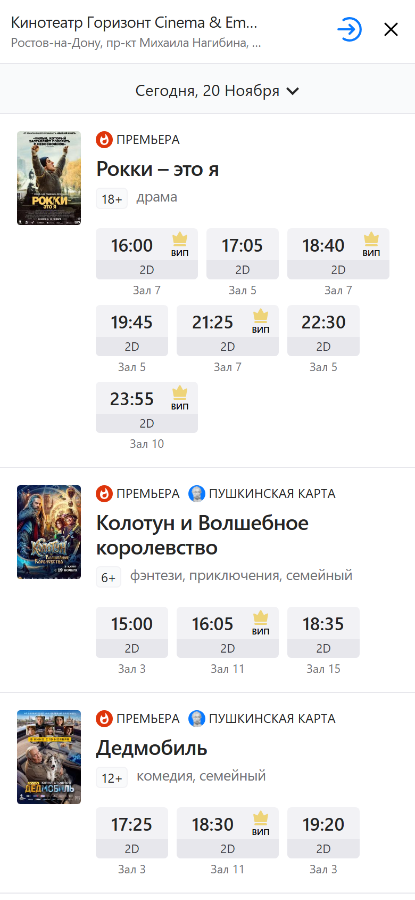

**Что работает:** сеансы — настоящие ссылки (`<a href="/seats/...">`), у постеров есть alt, лента времени в шапке зала позволяет переключиться без потери мест. Это стоит сохранить.

**Проблемы:**

| # | Наблюдение | Влияние |
|---|---|---|
| A1 | Название кинотеатра обрезано: «Кинотеатр Горизонт Cinema & Em…», адрес — «Ростов-на-Дону, пр-кт Михаила Нагибина, …» | Не понять, где покупаешь; для сети из нескольких площадок это риск купить не в тот зал |
| A2 | Дата — один селект «Сегодня, 20 Ноября ⌄»; полный список дней выпадает | +1 тап на любой не сегодняшний сеанс; дата не «читается» взглядом |
| A3 | В карточке сеанса нет цены, нет признака «мало мест» | Цену узнают только внутри зала — путь назад дорогой; популярные сеансы не сигнализируют о дефиците |
| A4 | Пять равновесных маркеров: «ПРЕМЬЕРА», «ПУШКИНСКАЯ КАРТА», корона VIP, «2D», «Зал 5» | Иерархия размыта; VIP обозначен иконкой-короной, а не словом — часть людей не считывает наценку 1050 ₽ против 450 ₽ |
| A5 | Две иконки в шапке без подписи: синяя стрелка («аккаунт») и крестик | Аккаунт для этого кинотеатра недоступен — ссылка возвращает в афишу (проверено). Пользователь тратит тап и теряет доверие |
| A6 | Афиша — длинный список без поиска и фильтров | «Что идёт после работы» требует листать 20+ фильмов |

### 3.1.1 Десктопная афиша: аудит и правки

Замеры до правок: список из двух колонок карточек шириной 396 px, постер 74 px, сеансы — сеткой три в ряд, дальше «Ещё 5 сеансов».

| # | Проблема | Влияние | Что сделано |
|---|---|---|---|
| D1 | Сетка карточек вместо списка строк | взгляд прыгает между колонками, фильмы сравнивать труднее | строки на всю ширину, разделители, постер 84 px слева |
| D2 | Сеансы зажаты в три колонки, справа от них пусто | не видно всех времён, нужно раскрывать «ещё» | сеансы текут «пилюлями» и переносятся, на десктопе показываются все |
| D3 | Нет поиска по названию | на длинной афише фильм приходится искать глазами | поле «Название фильма» |
| D4 | Фильтры были декоративными | нажатие меняло вид чипса и ничего не фильтровало | фильтры реальные: до 12:00, 12:00–17:00, после 17:00, Пушкинская карта, VIP-залы |
| D5 | Нет выделения ближайшего сеанса | непонятно, куда нажать, если пришёл «на сейчас» | первый по времени сеанс в каждом фильме подсвечен акцентной рамкой |
| D6 | «Ещё 5 сеансов» на десктопе при пустом месте справа | лишний клик | на ширине ≥900 px сеансы показываются все, кнопка скрыта |
| D7 | Пустой результат поиска никак не сообщался | человек думал, что афиша пустая | состояние «Ничего не найдено» с кнопкой «Сбросить фильтры» |

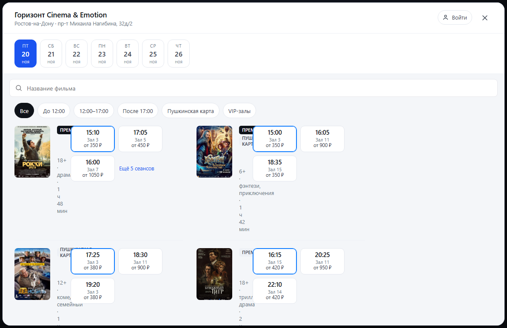
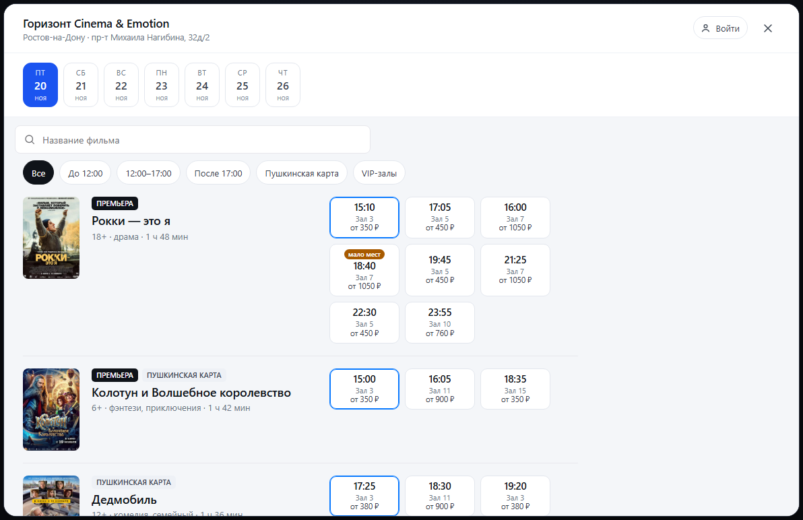
### 3.2 Схема зала

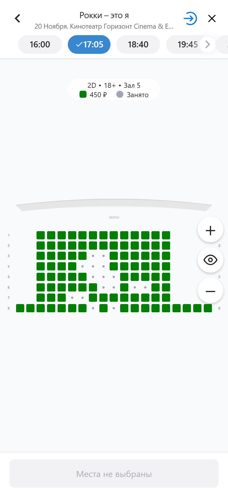
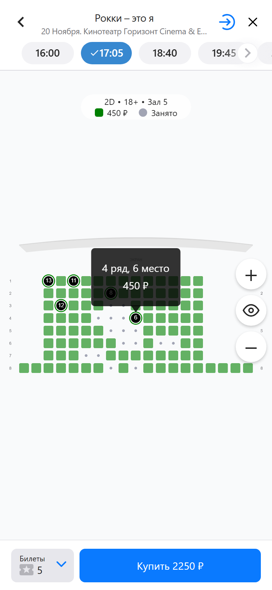

| # | Наблюдение | Влияние |
|---|---|---|
| S1 | Зал — canvas (Konva). Кресло ≈20×20 CSS px при ширине 390; по кадру `02-seats.png` (2×) выходит ≈13–14 CSS px — нужно перемерить | Промах по соседнему месту стоит денег и возврата; реальные тап-таргеты ниже 44 px в 2 раза |
| S2 | Пустое поле: экран-дуга на 40% высоты, сам зал — полоса ~15% площади, под ним ~300 px пустоты | Место, которое нужно вниманием, — самое мелкое на экране |
| S3 | Canvas без `role`, `aria-label`, `tabindex`; кресла не фокусируются | Купить билет с клавиатуры или скринридером невозможно |
| S4 | Номера мест нарисованы микрошрифтом внутри кресел, ряды — серым по краям | Сложно проверить «ряд 4, место 6» перед оплатой |
| S5 | Тултип выбранного места перекрывает ~треть зала, крестика нет | Нужно тапнуть мимо, чтобы увидеть схему; при 2+ местах тултип перекрывает соседей |
| S6 | Легенда объясняет только «450 ₽» и «Занято» | Состояния «выбрано»/«VIP» в легенде отсутствуют |
| S7 | Плавающие «+ / 👁 / −» поверх зала справа; «глаз» без подписи | Непонятно, что делает «глаз»; кнопки наезжают на кресла |
| S8 | «Билеты 5» — раскрывающийся список выбранных мест, накрывающий зал; карточки обрезаны по краю | Дублирует тултип, вместо помощи — ещё один слой поверх схемы |
| S9 | CTA меняет смысл: «Места не выбраны» → «Купить 2250 ₽» | Кнопка-статус вместо действия; сумма не сопровождает выбор, нет «2 места · 900 ₽» рядом |
| S10 | Нет подсказки «места рядом» и лимита выбора | На компанию из 4 человек подбор соседних мест — ручная работа с промахами |
| S11 | Предупреждение 18+ выезжает поверх зала и закрывает места, закрывать надо вручную | Каждый раз ломает первый контакт со схемой |
| S12 | Нет таймера удержания мест на этом экране | Таймер 15:00 появляется только на экране оплаты — поздно |
| S16 | **Отказ без обратной связи:** сверх лимита мест клик просто игнорируется; занятое место тоже не объясняет себя; CTA «Места не выбраны» не реагирует | Человек не понимает, почему нажатие не сработало, и пробует снова или уходит |
| S17 | **Нельзя сравнить сеансы по цене, не выходя из зала:** в зале показано только время начала, цены соседних сеансов не видны; чтобы понять, где дешевле, нужно возвращаться в афишу | Прямой сценарий «прокликать сеансы и выбрать, когда дешевле» занимает несколько переходов и сбрасывает выбор места |
| S13 | **Нет цен по зонам.** В легенде одна цена («450 ₽»), хотя в зале есть VIP-места и разные тарифы (в соседнем зале того же кинотеатра сеанс стоит 1050 ₽) | Пользователь узнаёт реальную цену только в корзине — это отказ на оплате и споры на кассе |
| S14 | **Цену нельзя узнать до выбора.** Нет ни ховера, ни карточки места | При зональных ценах человек сначала выбирает, потом узнаёт цену — обратный порядок решения |
| S15 | В списке сеансов цена без «от» | При разных ценах в зале цифра вводит в заблуждение |

### 3.2.1 Обратная связь на отклонённые действия

Отдельный класс дефектов: система **молча отклоняет** действие. В живом виджете так ведут себя три сценария — лимит мест, занятое место, неактивная кнопка «Купить». С точки зрения законов UX это два нарушения сразу:

| Правило | Источник | Что нарушено |
|---|---|---|
| **Видимость статуса** — система сообщает, что происходит | Нильсен, эвристика 1 (курс «UX/UI: Doing Design Right», гл. 4, с. 3) | после клика не меняется ничего: ни сообщения, ни индикатора, ни состояния |
| **Помощь в распознавании и исправлении ошибок** — что случилось, почему, что делать | Нильсен, эвристика 9 (там же, гл. 12, с. 11) | причина отказа не названа, следующий шаг не предложен |
| **Профилактика ошибок** — условие ошибки убирают до действия | Нильсен, эвристика 5 (там же, гл. 8, с. 7) | лимит виден только после того, как в него упёрлись |
| **Ошибка показывается там, где случилась** | Тидвелл, «Разработка интерфейсов», гл. «Error Messages», с. 525–531 | сообщения нет вообще, показать негде |
| **Делай ошибки невозможными, а не объясняй их** | Купер, «About Face», гл. 21, с. 671–682 | можно было заранее показать «6 из 6» и что делать дальше |

**Как исправлено в макете:**

1. **Профилактика.** Счётчик в шапке листа при достижении лимита меняет текст на «лимит 6» и цвет на предупреждающий; в лист сразу выводится объяснение «Выбрано 6 — это максимум на один заказ».
2. **Реакция на конкретное действие.** Клик по седьмому месту даёт короткий «толчок» места и сообщение рядом с листом: «Больше 6 мест за один заказ нельзя. Оформите эти или снимите одно — цена пересчитается». Место при этом не выбирается, выбор остаётся прежним.
3. **Занятое место.** Кресло больше не `disabled` (заблокированная кнопка глотает нажатие и человек не узнаёт причину): клик даёт «Это место уже занято — выберите свободное рядом», на десктопе ещё и карточку с ценой при наведении.
4. **Неактивное действие.** Нажатие «Оформить» без мест больше не молчит: «Сначала выберите хотя бы одно место на схеме».
5. **Доступность.** Подсказка — `role="status"` + `aria-live="polite"`, занятые места — `aria-disabled` вместо `disabled`, сообщение не отбирает фокус у схемы.
6. **Движение.** «Толчок» — 200 мс, отключается при `prefers-reduced-motion`; сообщение появляется за 180 мс.

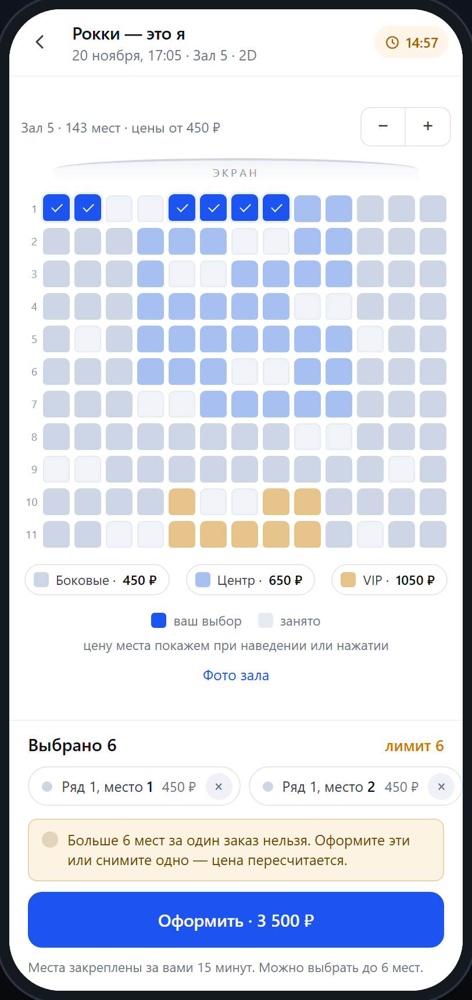
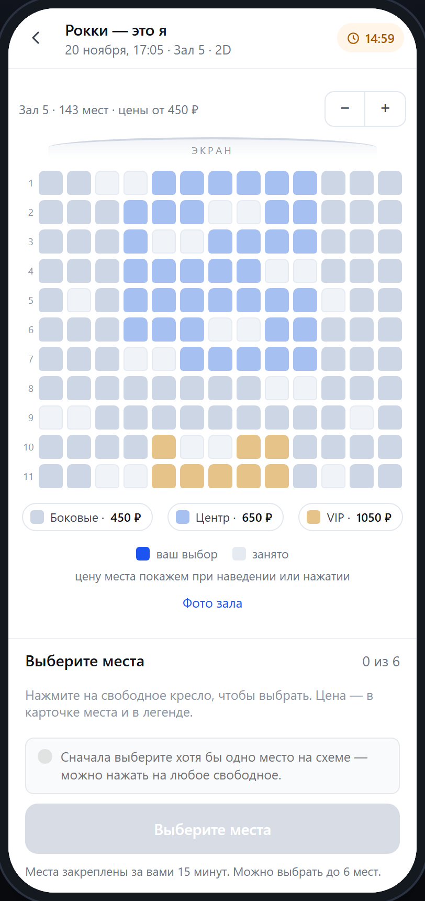
### 3.3 Контакты


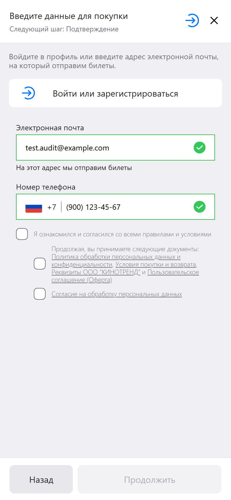

| # | Наблюдение | Влияние |
|---|---|---|
| C1 | Пустой белый экран: 3 поля и юридический блок, ~60% площади пустует; нет ни фильма, ни суммы | Ключевой экран доверия выглядит как форма ради формы |
| C2 | Три чекбокса, второй подписан «Продолжая, вы принимаете следующие документы…» — то есть противоречит сам себе | Юридический шум + ощущение подвоха |
| C3 | «Продолжить» disabled, без подсказки и без реакции на клик | Тупик без выхода |
| C4 | Заголовок «Введите данные для покупки»; прогресс — только мелкой серой строкой «Следующий шаг: Подтверждение» | Канцелярит и слабая ориентация в сценарии |
| C5 | Кнопка «Войти или зарегистрироваться» на всю ширину, но аккаунт в этом кинотеатре не работает | Ложное обещание, потерянный тап |
| C6 | Телефон обязателен без объяснения зачем | Лишний барьер без причины; объяснение «для возврата» снимает вопрос |
| C7 | Нет автоподсказок и подстановки прошлых данных (в рамках сессии данные сохраняются, но не предзаполняются при новой покупке) | Повторная покупка каждый раз с нуля |

### 3.3.1 Авторизация и повторные покупки

| # | Наблюдение | Влияние |
|---|---|---|
| U1 | В шапке — синяя стрелка без подписи (это вход/регистрация, судя по `alt="Регистрация"` у иконки), рядом крестик | Две безымянные иконки: человек не понимает, что это вход |
| U2 | Нажатие на иконку ведёт на `/account/login`, но для этого кинотеатра адрес сразу возвращает в афишу — сценария входа нет | Ложный вход: пользователь нажимает и попадает туда же |
| U3 | На «Контактах» есть кнопка «Войти или зарегистрироваться» на всю ширину, но за ней ничего нет | Обещание входа без входа — потерянный тап и доверие |
| U4 | Нет ни профиля, ни истории покупок: после оплаты единственный след — письмо с билетом | Нет возврата «а где мои билеты», нет повторной покупки в один экран, нет самостоятельного возврата |
| U5 | Нет сохранённых контактов и карты между покупками (данные сессии подставляются, но новой покупке не помогают) | Повторный покупатель каждый раз вводит всё заново |
| U6 | Нет бонусов/лояльности в виджете, хотя на кассе они могут быть | Нет причины выбирать виджет вместо кассы для постоянного зрителя |

**Важное уточнение к первому редизайну:** я убрал эту ветку целиком — это ошибка, исправлена в макетах (см. `audit/after/14-auth-phone.png` … `19-profile.png`). Правильный ответ: вход по СМС доступен из шапки и с оформления, гостевой сценарий сохраняется полностью.
### 3.4 Проверка заказа

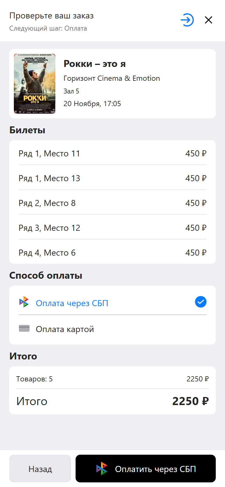

| # | Наблюдение | Влияние |
|---|---|---|
| B1 | «Итого» продублировано дважды: «Товаров: 1 … 1050 ₽» и «Итого 1050 ₽» | Визуальный шум на экране, где нужна максимальная ясность |
| B2 | Места — таблица «Ряд 2, Место 12 … 1050 ₽» без удаления и без перехода назад к схеме | Ошибку в месте нельзя исправить на месте |
| B3 | СБП уже выбрана за пользователя; «Оплата картой» — серый прямоугольник без брендов | Оплата — момент максимального недоверия, а здесь даже логотипов платёжных систем нет |
| B4 | Чёрная кнопка «Оплатить через СБП» при синем акценте продукта | Два конкурирующих акцента, основной CTA не самый заметный элемент |
| B5 | Нет промокода и сертификата; при этом на афише фильмы помечены «Пушкинская карта» | Обещанный на афише способ оплаты в виджете не поддержан (требует проверки в настройках кинотеатра) |

### 3.5 Оплата

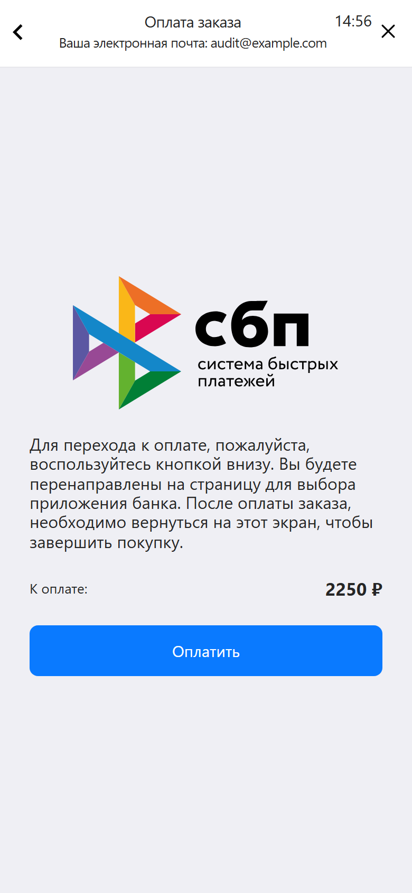

| # | Наблюдение | Влияние |
|---|---|---|
| P1 | На экране только email, сумма и кнопка — ни фильма, ни сеанса, ни мест | Если пользователь вернулся по таймеру, он не уверен, что платит за то |
| P2 | Инструкция из 5 строк: «будете перенаправлены… после оплаты необходимо вернуться на этот экран» | Прямое предупреждение о том, что сценарий сломается |
| P3 | Таймер 15:00 без объяснения, что именно истекает | Тревога вместо ясности («места держим 15 минут») |
| P4 | Нет «Я оплатил / проверить оплату», нет способа восстановиться, если вернулся не туда | Один сценарий, без страховки |

### 3.6 Десктоп

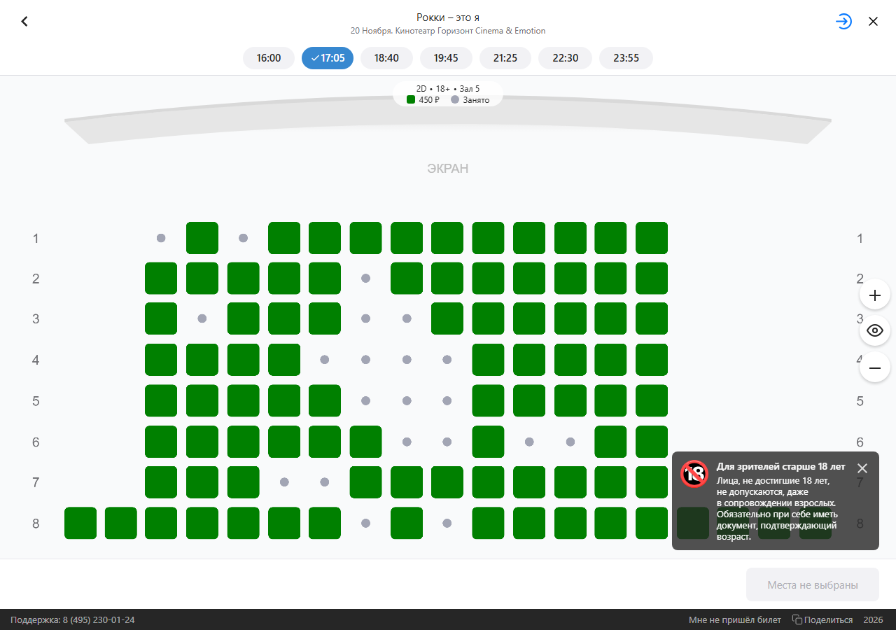

Зал растянут на 1280 px, кресла огромные, но правые 25% экрана пусты — при этом панели заказа на десктопе нет вообще. Десктопом пользуются в кассах и на стойках, где важно быстро оформить несколько билетов; сейчас это тот же мобильный макет, растянутый по ширине.

---

## 4. Метрики, которые это объясняют (что мерить)

Чтобы аудит превратился в управляемое улучшение, нужны разрезы по шагам виджета. Сейчас в виджете нет ни одного события прогресса — это отдельный, самый дешёвый пункт работ.

| Метрика | Где считать | Зачем |
|---|---|---|
| CR по шагам: афиша → зал → контакты → оплата → успех | события `screen_view` каждого шага | Найти реальную точку потерь, а не предполагаемую |
| Доля отказов на «Контактах» | `contacts_view` без `contacts_submit` | Проверить гипотезу про три чекбокса и пустой экран |
| Время до первого выбранного места | `seats_view` → `seat_select` | Проверить эффект переработки схемы зала |
| Число тапов на покупку | сквозная сессия | Проверить эффект объединения шагов |
| Возвраты «билет не пришёл» | поддержка / веб-форма | Прямой индикатор проблемы возврата с экрана оплаты |
| Доля мобильных сессий и их CR против десктопа | платформа в URL | Подтвердить приоритет мобильного |

*Допущение:* текущие значения CR по шагам мне неизвестны, все оценки эффекта в `HYPOTHESES.md` — прогнозные и требуют замера «до».

---

## 5. Что менять: принципы редизайна

1. **Один экран — одно решение.** «Контакты» и «Проверка заказа» сливаются в один экран оформления со сводкой сверху и способом оплаты на нём же. Четыре шага превращаются в три: сеанс → места → оформление, оплата — финальное действие на том же экране.
2. **Сводка заказа всегда на виду.** Фильм, сеанс, места и сумма сопровождают пользователя с шага мест до оплаты.
3. **Один юридический чекбокс.** Ссылки на документы — внутри подписи; отдельного «продолжая, вы принимаете…» с чекбоксом нет.
4. **Кнопка всегда активна.** Нажатие ведёт к проблеме: подсветка поля, сообщение под ним, скролл к первому невалидному.
5. **Кресло — под палец.** Зал занимает экран, кресла ≥23 px с зоной попадания больше визуала, лимит выбора, таймер удержания с первого экрана зала.
6. **Оплата с брендами и сохранённой картой.** Карта по умолчанию, СБП рядом, сертификат и промокод в том же списке.
7. **После оплаты возвращать не просьбой, а экраном.** «Билеты готовы» с QR, чеком и отправкой в мессенджер вместо «вернитесь на этот экран».
8. **Ошибки как отдельные экраны.** «Места заняли» с альтернативами в один тап и «Платёж не прошёл» с повтором.

Макеты — `prototype/index.html` (интерактивно, мобильный и десктопный режимы). Скриншоты — `audit/after/`.


