# Что происходит по кнопке «Войти»

Спецификация поведения, а не картинка. Отвечает на вопросы: что видит человек, что происходит с выбранными местами и введёнными данными, как он возвращается, что при ошибках.

---

---

---

## 0.0 Как вход выглядит в продукте сейчас (экраны из Figma-файла)

Экраны выгружены из файла `vgDgIAeXyDavBWOQzSZLc4`, секция «Текущая версия» (node `7-32`), 6 состояний.

**Панель входа** (`audit/before/13-current-auth-panel.png`): выезжает справа поверх схемы зала, зал остаётся виден и затемнён.

| Элемент | Что есть |
|---|---|
| Заголовок | «Вход в профиль» + крестик |
| Поля | «Электронная почта», «Пароль» с иконкой «показать» |
| Кнопка | «Войти», неактивна до заполнения |
| Разделитель | «или» |
| **Быстрый вход** | чёрная кнопка **«Войти с Яндекс ID»** с красным логотипом |
| Ссылки | «Зарегистрироваться», «Не помню пароль» |

То есть в продукте уже есть быстрый вход — через **Яндекс ID**, и он визуально самый заметный элемент панели. Соцпровайдеров (Сбер ID, VK ID, Госуслуги) в текущей версии нет.

**Экран после входа** (`audit/before/14-current-contacts-authorized.png`) — тот самый, который в файле назван «Авторизованные контакты, **не пойму зачем**»: после входа человек видит ровно ту же форму «Введите данные для покупки» с теми же тремя чекбоксами, только почта и телефон предзаполнены и подсвечены зелёным.

**Вот причина ощущения «зачем»:** вход даёт только предзаполнение двух полей и ничего больше — ни сохранённой карты, ни скрытия полей, ни истории, ни возврата без письма в поддержку. Экономия — два поля, а цена — пароль.

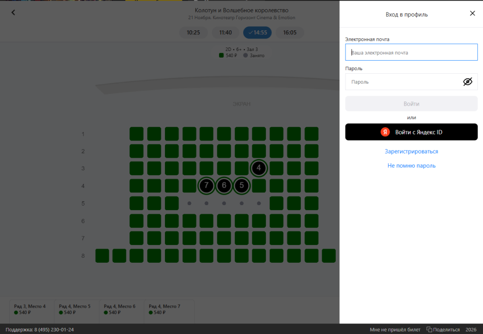
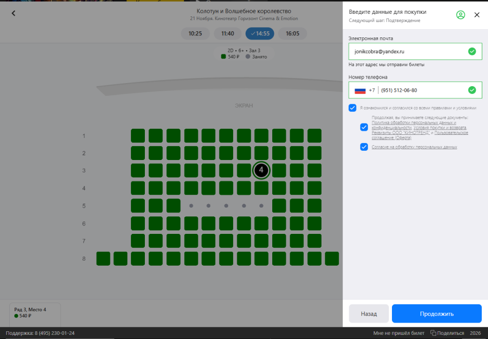

**Что из этого следует для редизайна:**

1. **Быстрый вход — Яндекс ID, как в продукте.** В макете он первый и заметный, остальные провайдеры спрятаны под «Другие способы входа», чтобы не превращать вход в витрину кнопок (закон Хика: шесть равнозначных вариантов дороже, чем один плюс раскрытие).
2. **После входа поля должны исчезать**, а не просто заполняться: остаётся строка «Вы вошли · телефон · сохранённая карта». Это и есть ответ на «зачем».
3. **Добавляем то, что вход окупает:** сохранённая карта, билеты и чеки в профиле, возврат без письма в поддержку.
4. **Пароль остаётся, но не как единственный путь:** телефон + код, Яндекс ID, а под раскрытием — Сбер ID / VK ID / Госуслуги / QR (Госуслуги — путь к Пушкинской карте и подтверждению возраста).

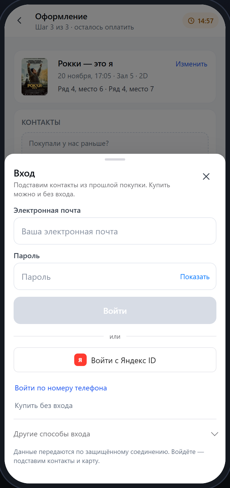

## 0. Как это сделано в Яндекс Афише (наблюдение 20.11.2026)

Прошёл живой сценарий: афиша → зал → оформление → подтверждение. Что увидел:

| Шаг | Что показывает Яндекс |
|---|---|
| Схема зала | тап/наведение на место открывает карточку: «3 ряд, 4 место · Премиум · 970 ₽»; сверху «Держим места 09:53» |
| Оформление | заголовок «Введите данные для получения билета», **два поля** — «Электронная почта» и «Номер телефона», один чекбокс «Купить билеты в подарок» |
| Кнопка | «Далее», неактивна до заполнения; под ней одна строка: «Нажимая «Далее», вы соглашаетесь с условиями приобретения» |
| Подтверждение | фильм, сеанс, зал, место, цена, «Итоговая стоимость», способы оплаты с пояснением, почему недоступны («Не подходит для оплаты»), поле «Введите промокод» |

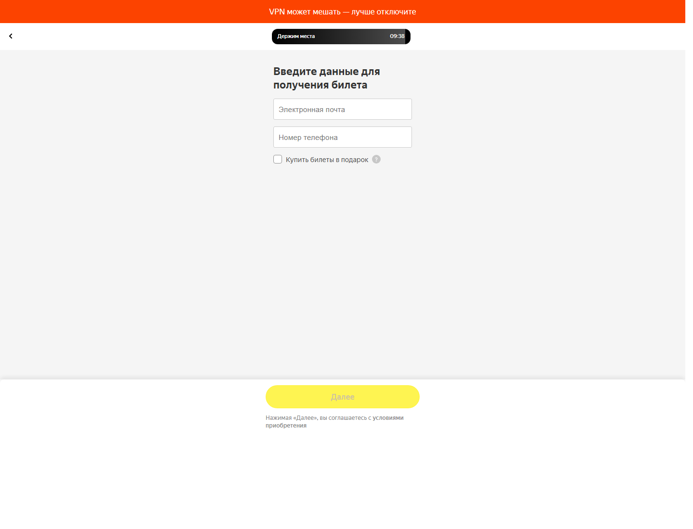

**Главное: в билетном виджете Яндекс нет ни кнопки «Войти», ни шага авторизации.** Покупка гостевая: email + телефон + «Далее». Вход существует отдельно, на уровне Яндекс ID, и для покупки билета не требуется.

**Что из этого следует для нас:** авторизация — необязательная ветка и не повод останавливать сценарий. Мой первый вариант шторки был перегружен: иллюстрация, блок «что даёт аккаунт», выдуманный профиль с именем и бонусами. Это выглядело как реклама регистрации там, где человек просто хочет купить билет.

**Как исправлено:**
- в шторке остались телефон, «Получить код» и три пути: email, номер билета, покупка без входа;
- убраны иллюстрация, промо-блок, имя и бонусы;
- после входа видно только «Вы вошли · +7 900 123-45-67 · сохранённая карта» — без выдуманной личности;
- оформление гостя повторяет структуру Яндекса: сводка, два поля, одна галочка, кнопка и строка согласия под ней.

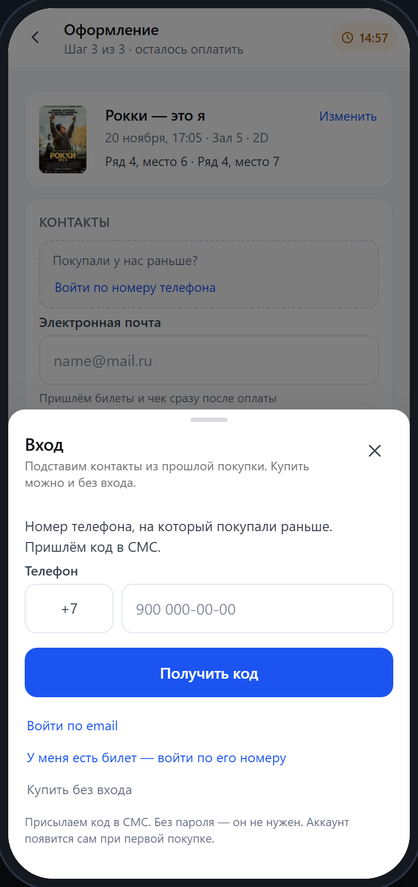
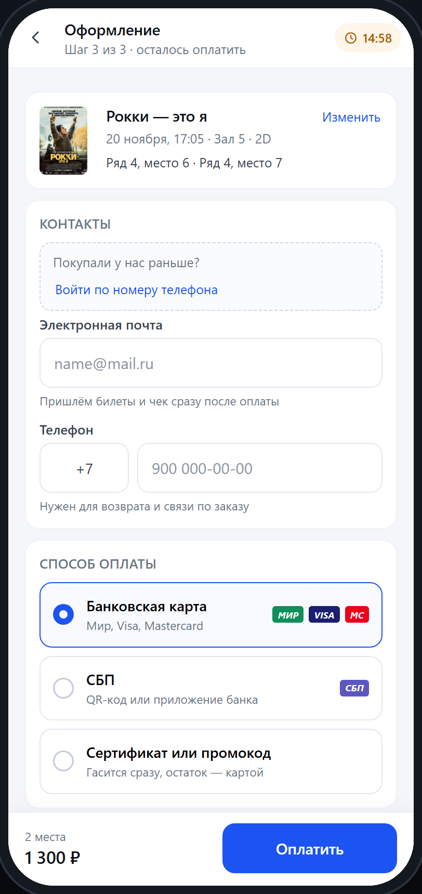

Разница с Яндексом, которую оставляю осознанно: у нас три чекбокса сведены к одному, а у Яндекса согласие — текст под кнопкой. Юридическую форму согласия нужно подтвердить у юриста кинотеатра: текст под кнопкой проще, отдельный чекбокс надёжнее.
---

## 0.1 Быстрая авторизация через сервисы (наблюдение)

Смотрел два сервиса Яндекса, где вход реально нужен.

**Яндекс ID** (`passport.yandex.ru`): почта или телефон + «Далее», плюс два способа без ввода пароля — **«По лицу или отпечатку»** и **«QR-код»**. Соцпровайдеров нет: Яндекс сам себе провайдер.

**ЮKassa / ЮMoney** (`yoomoney.ru/yooid/signin`) — это про то, что ты имел в виду:

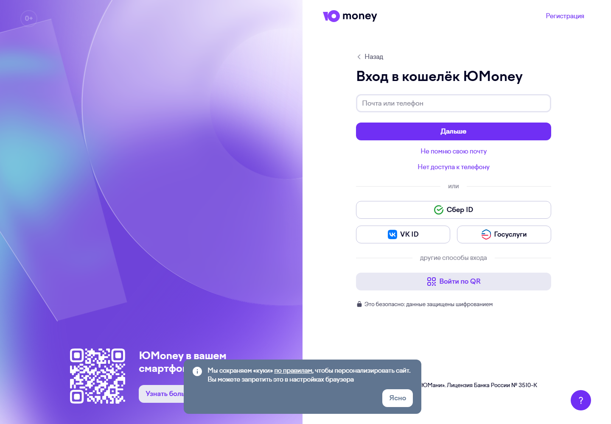

| Элемент | Как оформлен |
|---|---|
| Поле | «Почта или телефон» → «Дальше» (один шаг, без пароля) |
| Подсказки | «Не помню свою почту», «Нет доступа к телефону» |
| Разделитель | «или» |
| **Сбер ID** | отдельная кнопка на всю ширину, логотип + название |
| **VK ID · Госуслуги** | две кнопки в ряд, равные |
| Прочее | «другие способы входа» → **«Войти по QR»** отдельной кнопкой |
| Доверие | «Это безопасно: данные защищены шифрованием» |

**Что взял в макет:**
1. Телефон + «Получить код» — основной путь (так же, как у ЮKassa).
2. Разделитель «или» и три сервиса: **Сбер ID** (широкой кнопкой), **VK ID** и **Госуслуги** (в ряд).
3. **«Войти по QR-коду»** — тихой кнопкой ниже.
4. Строка доверия про защищённое соединение.
5. «Купить без входа» остаётся последним пунктом.

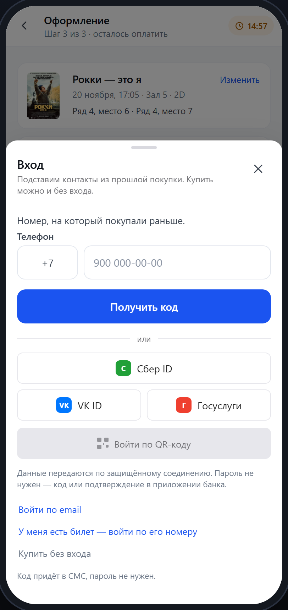
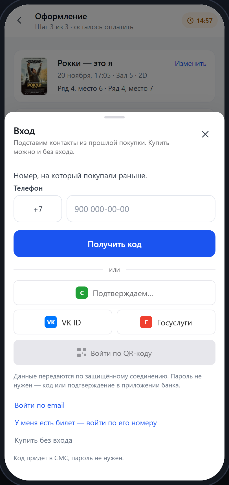
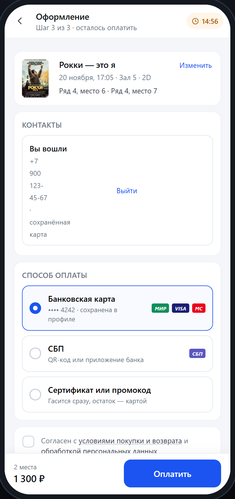

**Почему Госуслуги важны именно нам:** через ЕСИА подтверждается возраст и Пушкинская карта. Для сегмента 14–22 лет это не «ещё одна кнопка», а способ купить билет по Пушкинской карте без ручного ввода.

**Что нужно от продукта, а не от макета:**
- юридические договорённости с каждым провайдером (Сбер ID, VK ID, ЕСИА) и официальные логотипы — в макете сейчас монограммы-заглушки;
- решение, что делать при конфликте аккаунтов: у человека есть аккаунт по телефону и он входит через VK ID с другим номером — слияние или выбор;
- политика хранения: какие данные провайдер отдаёт (телефон, email), что мы сохраняем.
---

## 0.2 Платформы: шторка снизу и панель справа

| Платформа | Форма | Размер | Почему |
|---|---|---|---|
| Мобильный | нижняя шторка, скругление сверху, ручка | вся ширина, до 92% высоты | большой палец внизу, привычный жест |
| Десктоп | **правая панель** | 392 px, на всю высоту | как в текущем продукте: зал и заказ остаются видны слева, ничего не растягивается |

Первая версия на десктопе оставалась нижней шторкой на всю ширину: поля по 900 px, кнопки во всю ширину — пользоваться неприятно. Это была ошибка, а не стилистика. Исправлено: на ширине ≥900 px оверлей выравнивается вправо, панель фиксированной ширины, ручка скрыта, поля ограничены.

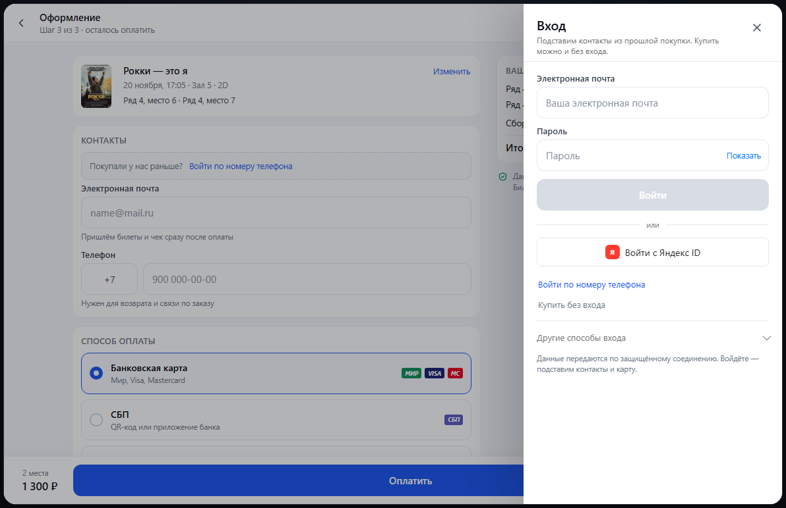
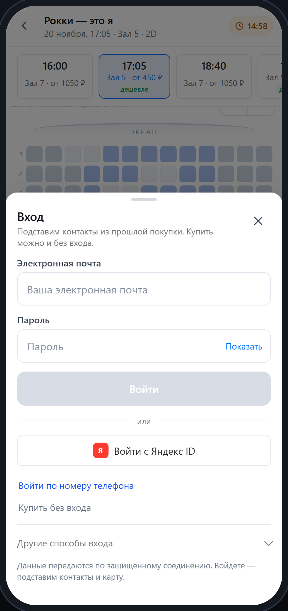
## 1. Где кнопка и что она открывает

| Точка входа | Что видно | Куда открывается | Куда возвращает |
|---|---|---|---|
| Шапка афиши | кнопка «Войти» с иконкой | оверлей-шторка снизу (мобильный) / модалка по центру (десктоп) | на афишу, на то же место скролла |
| Оформление, полоса «Уже покупали здесь?» | тихая ссылка «Войти — контакты и карта подставятся» | та же шторка **поверх оформления** | обратно в оформление, места и поля сохранены |
| Профиль (после входа) | аватар и имя вместо «Войти» | открывает экран профиля | — |

**Главное правило:** вход — это оверлей, а не переход на отдельный экран. Экран под ним не размонтируется: выбранные места, сеанс и введённые контакты остаются в состоянии. Человек не теряет корзину из-за решения войти.

**Почему не отдельный экран:** в текущем виджете вход открывается как отдельная страница `/account/login`, и на этом кинотеатре возвращает в афишу — то есть выкидывает из сценария. Оверлей эту проблему снимает структурно.

---

## 2. Состояния шторки

```
[idle]                     шторка закрыта
   │ тап «Войти»
   ▼
[phone]  ── телефон ──▶  [code]  ── верный код ──▶  [success]  ──▶ закрытие + возврат
   │  ▲                    │  │
   │  └── «Изменить номер»┘  └── неверный код ──▶ ошибка под полями (шторка остаётся)
   │
   └── «Продолжить как гость» / крестик / Esc / тап по фону ──▶ закрытие без входа
```

| Шаг | Элементы | Поведение |
|---|---|---|
| phone | поле телефона, «Получить код», «Войти по email», «У меня есть билет — войти по его номеру», «Продолжить как гость» | «Получить код» активна только при 10 цифрах; ошибка — под полем, не всплывашкой |
| code | 4 поля кода, «Войти», «Отправить код снова через 00:59», «Изменить номер» | автопереход фокуса между полями, Backspace возвращает назад, вставка кода из СМС заполняет все 4 |
| success | — | шторка закрывается сама через 300 мс, внизу появляется тост «Вы вошли как Анна» |

**Анимация:** шторка выезжает снизу за 300 мс (`motion/ease`), фон затемняется за 200 мс. На десктопе модалка появляется за 200 мс с масштабом .98 → 1. Закрытие — 180 мс на opacity, без резкого исчезновения. При `prefers-reduced-motion` — мгновенно.

---

## 3. Что происходит с данными

### 3.1 Если контакты ещё не вводились
Поля оформления заполняются из аккаунта (email и телефон), поля скрываются, вместо них — карточка «Анна Ковалёва · +7 900 … · бонусов 120».

### 3.2 Если контакты уже введены и не совпадают с аккаунтом
Данные аккаунта **побеждают**, но человек это видит и может вернуть своё:

> «Контакты заменили на данные аккаунта — [вернуть введённые]»

Это важно: молча подменить email, на который человек ждёт билеты, — худший вариант.

### 3.3 Если выбранные места уже есть
Ничего не происходит: места остаются выбранными, таймер удержания продолжает идти. Если к моменту возврата таймер истёк — показываем экран «места освободились» с альтернативами (см. `audit/after/09-error-seat.png`).

### 3.4 Если у аккаунта есть неоплаченный заказ
В шторке после успешного входа появляется блок:

> «У вас есть незавершённый заказ: Рокки — это я, 20 ноября, 17:05, 2 места. [Вернуться к нему] [Продолжить с текущими]»

Текущий выбор по умолчанию не сбрасывается.

### 3.5 Выход из аккаунта на оформлении
Поля возвращаются к последним введённым значениям (или пустые), места сохраняются, сохранённая карта и бонусы исчезают из способов оплаты. Действие без подтверждения — оно обратимо.

---

## 4. Ошибки и края

| Случай | Что видит человек |
|---|---|
| Неверный код | красная подсветка четырёх полей + «Код не подошёл. Проверьте цифры или запросите новый» |
| Код просрочен | «Код действует 5 минут. Отправьте новый» + кнопка активна |
| СМС не приходит | под таймером ссылка «Не приходит? Войти по email» |
| Номер не найден | аккаунт не нужен для ошибки: код всё равно уходит, аккаунт создаётся при первой покупке |
| Аккаунт заблокирован | «Вход недоступен. Продолжите как гость — билеты придут на почту» |
| Нет сети / запрос упал | «Не удалось проверить код. Проверьте связь и повторите», введённые цифры не стираются |
| Пользователь закрыл шторку | возврат в исходное состояние без потери мест; введённое в полях сохраняется |
| Вход в другой вкладке | при возврате фокуса шапка обновляется на «Анну», сценарий не ломается |
| Сессия истекла во время оплаты | после перезагрузки человек видит свой заказ и предложение войти снова |

**Правило:** ни один из этих случаев не должен возвращать человека на афишу. Сценарий либо продолжается, либо остаётся на месте с понятным следующим шагом.

---

## 5. Аналитика (что логируем)

| Событие | Когда | Зачем |
|---|---|---|
| `auth_open` | открытие шторки | доля сценариев, где вход вообще заметили |
| `auth_open_source` = `header` / `checkout` | вместе с открытием | какая точка входа работает |
| `auth_code_requested` / `auth_code_failed` | запрос и ошибка кода | качество доставки СМС |
| `auth_success` | успешный вход | CR входа |
| `auth_dismissed` + `step` | закрытие без входа | где именно отваливаются |
| `auth_contacts_replaced` / `auth_contacts_restored` | конфликт контактов | как часто аккаунт затирает введённое |
| `auth_after_seats` | вход при уже выбранных местах | вход в середине сценария |

---

## 6. Доступность

- Шторка — `role="dialog"`, `aria-modal="true"`, заголовок связан через `aria-labelledby`.
- Фокус переходит в первое поле, Tab ходит только внутри шторки, Esc закрывает, фокус возвращается на кнопку, которая открыла.
- Поля кода — четыре отдельных `input` с `aria-label` «Цифра кода 1…4», вставка из буфера заполняет все.
- Ошибка объявляется через `aria-live="polite"`.
- Кнопка «Продолжить как гость» доступна с клавиатуры и не спрятана за скроллом.

---

## 7. Что осталось решить

1. **Вход по email и по номеру билета** — в прототипе это заглушки, ведущие в тот же шаг телефона. Нужен реальный контракт: email-код или поиск заказа по номеру.
2. **Слияние гостевого заказа с аккаунтом** — если человек купил гостем, а потом вошёл, заказ должен появиться в профиле. Требует решения на бэкенде.
3. **Окно «незавершённый заказ»** — нужно, чтобы бэкенд отдавал черновик заказа по пользователю, иначе блок показывать нечем.
