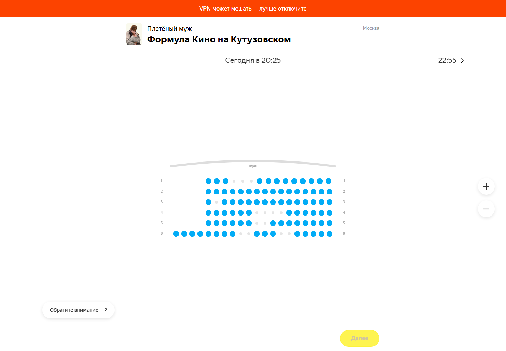
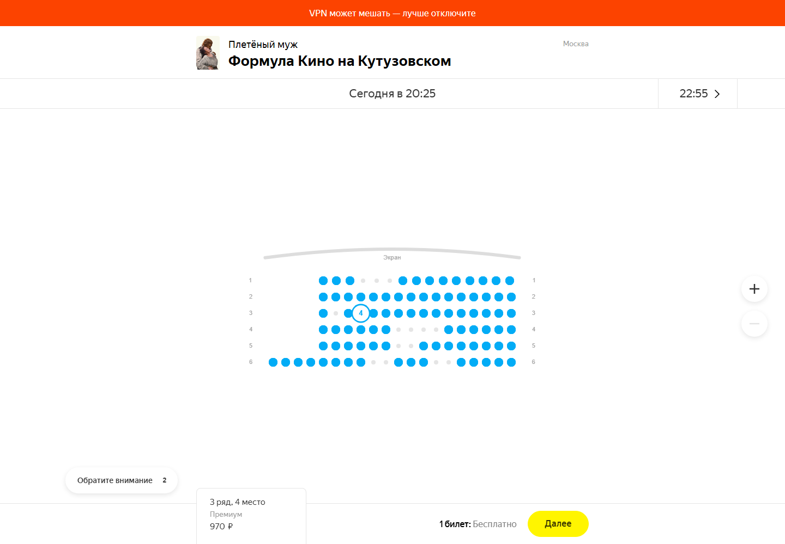
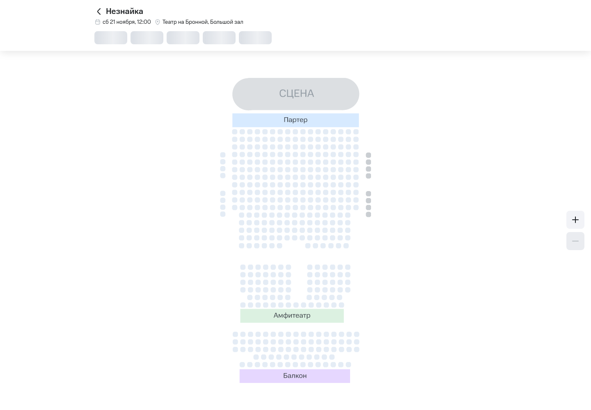
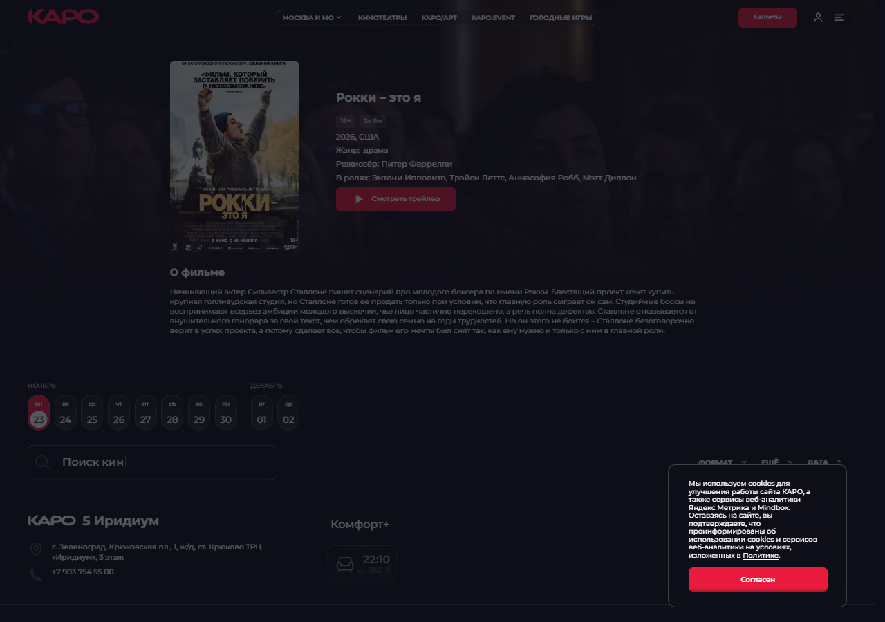

# Бенчмаркинг схем выбора мест

Что смотрел, что получилось снять, и какие выводы это даёт для нашего виджета.
Дата: 20 ноября 2026 (Фритаун/p24 и расписание КАРО — 23 ноября). Снято вживую в десктопном Chrome (1440×1000), где сервис не блокирует автоматический доступ.
Сводный анализ рынка (10 сервисов, SWOT, фичи, как подать) — [competitive_analysis_final.md](competitive_analysis_final.md).

---

## 1. Что удалось проверить вживую

| Сервис | Что видел | Схема зала | Файл |
|---|---|---|---|
| **Яндекс Афиша** (виджет кино) | сеанс «Плетёный муж», Формула Кино на Кутузовском | доступные места — **заливка синим кругом**, занятые — бледно-серые точки, дуга экрана с подписью «Экран», номера рядов с двух сторон, зум +/−, основная кнопка «Далее»; **после выбора места — карточка «3 ряд, 4 место · Премиум · 970 ₽»** | `audit/bench-yandex-afisha.png`, `audit/bench-yandex-seatcard.png` |
| **Ticketland** (театр) | «Незнайка», Театр на Бронной, Большой зал | зоны подписаны **цветными полосами-заголовками**: «Партер» (голубой), «Амфитеатр» (зелёный), «Балкон» (сиреневый); сами кресла однотонные, цен в кадре нет; зум +/− справа; в шапке спектакль, дата, площадка | `audit/bench-ticketland-zones.png` |
| **КАРО** | «Рокки — это я», КАРО 5 Иридиум, зал «Комфорт+» | дата-лента, блок кинотеатра и зала, сеанс 22:10 **«от 360 ₽»** | `audit/bench-karo-schedule.png` |
| **Кассир.ру** | «Свадьба Кречинского», Малый театр | на карточке события диапазон «**1 100 – 5 200 ₽**», кнопка «Билеты от 1 100 ₽»; сама схема — во вложенном билетном модуле | текстом с карточки события |
| **МТС Live** | «Кишлак», МТС Live Холл | цена «от 800 ₽» на карточке, схема — в партнёрском модуле | текстом |

**Что не удалось снять и почему:** AMC, Atom Tickets, Cineplex, Vue, Odeon, Kinoafisha — Cloudflare/гео-запрет; Eventim — Akamai «Access Denied»; Telecharge — интерфейс не отдаёт разметку без входа. Эти сервисы в выводах ниже учитываю по документации их движков (seats.io используется в Ticketmaster, Eventim, Broadway-сервисах) и не выдаю за собственный замер.

---

## 2. Что подтверждают документы движков

**[seats.io — objectPopover](https://docs.seats.io/docs/renderer/config-objectPopover/)** (движок схем для Ticketmaster, Eventim и др.):
- всплывающая карточка «при наведении мышью **или при тапе на объект на тач-устройствах**» — то есть ховер и тап считаются одним паттерном, а не разными;
- `showPricing: true` **по умолчанию** — в карточке показывается цена категории, к которой относится место;
- `showCategory: true` — цвет и название категории (зоны);
- `confirmSelection: 'auto'` (по умолчанию) — на тач-устройствах первый тап **показывает карточку-подтверждение**, а не выбирает место сразу; на десктопе выбор идёт кликом после ховера.

**[Cinemabox — экран выбора мест](https://wiki.cinemabox.team/books/kassa/page/ekran-vybora-mest)** (кассовое ПО российских кинотеатров):
- среди элементов экрана прямо назван пункт «**Ценовые пояса**, которые используются в схеме зала»;
- цвета ценовых поясов настраиваются отдельно и отличаются от цветов «выбрано / забронировано / продано»;
- занятые места — серые и недоступны для выбора.

**[Freddie Mac — чеклист проектирования схемы мест](https://www.frediemac.com/styleguide/files/Design-Seating-Plans-Checklist.pdf)**: первый вопрос чеклиста — «какие у нас ценовые уровни и скидочные билеты», затем «нужен ли нормализованный масштаб, чтобы уменьшить промахи (rage taps)».

**Вывод:** индустрия сходится на трёх правилах — доступные места залиты цветом, цена видна до подтверждения покупки (в карточке места или в списке сеансов), ценовые зоны различимы и подписаны. Но способы разные: у Яндекса цена и категория — в карточке после выбора места, у Ticketland — только подписи зон без цен, у КАРО — «от» в сеансе.

---

## 3. Сравнительная таблица

| Признак | Киноплан (сейчас) | Яндекс Афиша | Ticketland | КАРО | seats.io (движок) |
|---|---|---|---|---|---|
| Доступное место | заливка зелёным, без границ | **заливка синим кругом** | заливка светлым, зоны — полосами-заголовками | нет данных по схеме | заливка цветом категории |
| Занятое место | бледно-серый | бледно-серая точка | серый | — | светлый/неактивный цвет |
| Выбранное место | кружок с номером поверх места | (после выбора) акцент + счётчик | акцент | — | акцент + карточка |
| **Цена на месте / при наведении** | **нет** | **после выбора места: карточка «Премиум · 970 ₽»** | в кадре нет | **«от 360 ₽» в списке сеансов** | **есть, в карточке места** |
| Ценовые зоны | **есть в больших залах** (430/500/530 ₽), в проверенном Зале 5 — одна цена | категория есть в карточке, зон на схеме нет | **да, цветные полосы + названия, без цен** | зал/тариф в сеансе | **да, категории и цвета** |
| Первый тап на телефоне | сразу выбирает | тап выбирает место, карточка показывает цену | сразу выбирает | — | **показывает карточку с ценой** |
| Легенда | цена + «занято» | нет; цена в карточке места | полосы зон, без цен | — | категории с ценами |
| Экран/сцена на схеме | дуга с подписью «ЭКРАН» | дуга с подписью «Экран» | блок «СЦЕНА» | — | зависит от площадки |
| Зум | + / − / «глаз» | **+/− справа** | **+/− справа** | — | есть |
| Заголовок в шапке схемы | фильм + дата (обрезается) | фильм + кинотеатр + время | спектакль + дата + площадка | — | конфигурируется |
| Доступность с клавиатуры | canvas, недоступно | элементы в DOM, клавиатурой не проверял | элементы в DOM, клавиатурой не проверял | — | встроенный режим пошагового выбора |

---

## 4. Что это значит для нас

### 4.1 Доступные места — заливкой, а не контуром
В редизайне я сделал свободные места контуром, «чтобы цвет означал выбор». Бенчмарк показывает, что это исключение: в Яндекс Афише, Ticketland и в движке seats.io свободное место — **заливка**, а контур/светлый цвет — занятое. Контур на белом фоне читается как «недоступно» и разваливает сканирование зала: пользователю нужно заново выучить код.

**Решение:** доступные места — заливка. Цвет заливки — не «красиво», а **признак ценовой зоны** (см. ниже). Выбранное место — единственный элемент с акцентным цветом бренда и галочкой.

### 4.2 Цена должна быть видна до выбора
В одном зале цены разные: боковые дешевле, центр дороже, VIP — ещё дороже. В проверенном Зале 5
виджет показывает **одну** цену («450 ₽»), но в больших залах зоны уже есть: 430/500/530 ₽ и
легенда (кадр `audit/before/17-zones.png`). Значит, при зональных ценах виджет либо врёт, либо
заставляет узнать цену только в корзине. Это прямой путь к «а почему так дорого» на оплате.

**Решение — три уровня, деградирующие друг в друга:**
1. **Легенда ценовых зон** с цветом и ценой — всегда, на всех устройствах.
2. **Ховер (десктоп)** — карточка «Ряд 4, место 6 · Центр · 650 ₽» у курсора, выбор по клику.
3. **Тап (мобильный)** — первый тап показывает ту же карточку с ценой и кнопкой «Выбрать», второй тап (или кнопка) выбирает. Это поведение `confirmSelection: 'auto'` из seats.io (по умолчанию: на таче первый тап показывает карточку, а не выбирает) — и его же видно у Яндекса: место обведено, внизу карточка «3 ряд, 4 место · Премиум · 970 ₽».

**Главное — не факт тултипа, а его иерархия.** Ховер и тап с ценой есть почти у всех, включая
живой Киноплан. Проблема в том, что цена, ряд и место набраны одним весом, и цена сливается.
В прототипе цена стала главной (25 px), ряд и место — вторичными (11 px), зона — подписью:
`audit/after/69-seat-tooltip-price.png`. Это и есть доработка, которую стоит показывать.

### 4.3 Ценовые зоны — цветом и подписью
Ticketland подписывает зоны цветными полосами-заголовками («Партер», «Амфитеатр», «Балкон»), но сами кресла не красит и цен в кадре не показывает; Cinemabox называет это «ценовыми поясами». У Киноплан в больших залах уже есть цвет = цена и легенда; задача — сделать это системой, а не разовым состоянием, и не терять в залах с одной ценой.

### 4.4 Цена в списке сеансов — «от»
КАРО пишет «22:10 · от 360 ₽» (КАРО 5 Иридиум, «Комфорт+»), Кассир — диапазон «1 100 – 5 200 ₽». У нас в карточке сеанса цены нет вообще: цифра впервые появляется в корзине. При зональных ценах это неправда: нужно «от 450 ₽», а диапазон — в подсказке.

### 4.5 Сумма на кнопке: наша конвенция, не рыночная
У Яндекса кнопка «Далее», а сумма живёт рядом: «1 билет: Бесплатно» и карточка места «970 ₽». У Фритауна/p24 слева «350 ₽ · 1 билет ▾», справа «Продолжить». У Кассира сумма в карточке события, кнопка — «Билеты от 1 100 ₽». То есть рынок держит кнопку глаголом, а цену — отдельным блоком в той же нижней полосе.
Мы делаем иначе: сумма входит в подпись кнопки — «Оформить · 1 300 ₽», на оплате «Оплатить 1 300 ₽». Это осознанное отступление: в виджете нет отдельной нижней полосы с итогом, а сумма на главном действии снимает вопрос «сколько я заплачу» до нажатия. Цена на кнопке появляется только с момента выбора мест; до выбора — «Выберите места» в недоступном состоянии.

### 4.6 Мелочи, которые стоит забрать
- Дуга «ЭКРАН»/«СЦЕНА» с подписью — у всех, мы делаем так же (совпало).
- Зум «+/−» компактно сбоку — у Яндекса и Ticketland; мы убрали его из-под кресел в строку над схемой, это лучше, чем плавающие кнопки поверх мест.
- Номера рядов с **двух** сторон (Яндекс) — на широких залах помогает не терять ряд.
- Название площадки и зала в шапке схемы — Ticketland показывает полностью, у нас обрезается.

### 4.7 Чего в бенчмарке нет и что мы можем сделать лучше
- Никто из проверенных не предлагает **«места рядом» в один тап** для компании.
- Никто не показывает **сколько мест осталось в зоне** — а это тот же сигнал дефицита, что «мало мест» на карточке сеанса.
- Мобильный первый тап с подтверждением — плата за понимание цены; можно снизить её, показав цену прямо в чипсах зоны и добавив «Показывать цену при нажатии» в настройки (гипотеза H16 в `HYPOTHESES.md`).

---

## 4.7 Опубликованные кейсы

TodayTix (28,3 % брошенных корзин из-за невозможности выбрать место; двухшаговый выбор на телефоне; ценовые фильтры), Marcus Theatres (переключатель сеанса со схемы, вход по коду вместо 14-значного номера, метрики по этапам) и M‑Tix (проверка прототипа до запуска) разобраны в [PRACTICES.md](PRACTICES.md).

## 4.8 Десктопная афиша: как это устроено у конкурентов

Смотрел расписание площадки в Яндекс Афише и список фильмов в КАРО (1440 px).

**Яндекс Афиша** (`audit/bench-yandex-desktop-schedule.png`):

| Элемент | Решение |
|---|---|
| Список | **вертикальные строки**, а не сетка карточек; между фильмами тонкие разделители |
| Постер | ~80 px, слева |
| Текст | жанры мелким серым над названием, название ~18 px, формат «2D» отдельной колонкой |
| Сеансы | **времена подряд, в одну строку**, «пилюлями»; не поместившиеся переносятся на следующую строку |
| Подсказка о цене | цена не в пилюле; свободные/занятые отличаются цветом пилюли |
| Поиск | отдельное поле «Название фильма» над списком |
| Фильтры | пилюли «Сегодня ▾», «Весь день ▾», «Пушкинская карта» — **рабочие** |

**КАРО** (`audit/bench-karo-schedule.png`): дата-лента кружками, блок кинотеатра и зала («КАРО 5 Иридиум · Комфорт+»), сеанс «22:10 · от 360 ₽». Сетка постеров из `audit/bench-karo-desktop-schedule.png` — это каталог, а не расписание; для вывода о списке сеансов использую новый кадр.

**Вывод для нас:** на десктопе афиша — это **список строк**, а не сетка карточек. Пользователь сканирует сверху вниз: фильм → жанры → название → времена. Сетка из двух колонок ломает ритм: карточки разной высоты, сеансы зажаты в три колонки, справа пусто.
## 5. Источники

- [Яндекс Афиша — виджет сеанса](https://widget.afisha.yandex.ru/) (наблюдение, скриншот выше)
- [Ticketland — схема зала](https://www.ticketland.ru/) (наблюдение, скриншот выше)
- [КАРО — расписание](https://www.karofilm.ru/film/16811) (наблюдение 23.11.2026: зал «Комфорт+», «22:10 · от 360 ₽»)
- [Кассир.ру — карточка события](https://msk.kassir.ru/) (наблюдение: диапазон цен)
- [seats.io — objectPopover](https://docs.seats.io/docs/renderer/config-objectPopover/) — ховер/тап, показ цены и категории, подтверждение выбора на таче
- [Cinemabox — экран выбора мест](https://wiki.cinemabox.team/books/kassa/page/ekran-vybora-mest) — «ценовые пояса», цвета зон и состояний
- [Freddie Mac — Seating Plans Design Checklist](https://www.frediemac.com/styleguide/files/Design-Seating-Plans-Checklist.pdf) — ценовые уровни, промахи, нормализация масштаба
- [Патент US20230419194 — seat pricing color key](https://patents.google.com/patent/US20230419194A1) — легенда цен прямо на схеме зала

### 4.5.1 Подписи кнопок по шагам (25.11)

У конкурентов кнопка шага — глагол-шаг, без суммы: Яндекс на оформлении даёт «Далее» (udit/bench-yandex-checkout.png), Фритаун после выбора места — «Продолжить» (udit/bench-freetown-selected.png), сумма у обоих живёт отдельным блоком. Мы держим ту же логику по шагам: на зале кнопка с суммой («Оформить · 1 300 ₽»), потому что другого места с итогом на этом шаге нет; на оформлении — просто «Перейти к оплате», сумма есть в плашке заказа; на оплате — «Оплатить».
