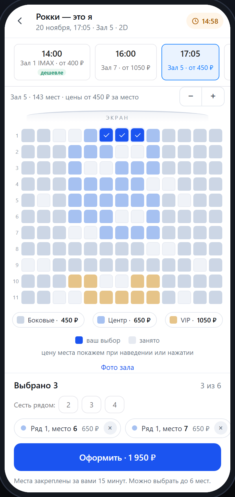
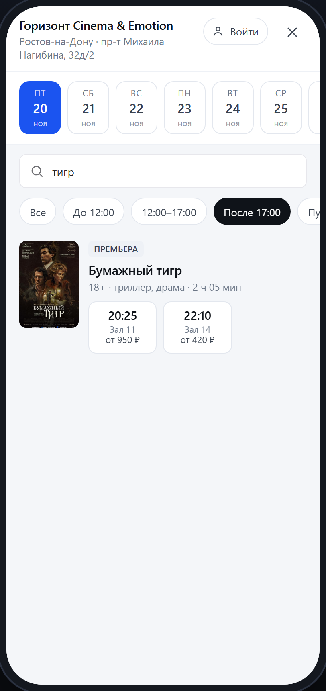

# Персоны, потоки и что из них следует для интерфейса

> **Версия 24.11.2026, четвёртая.** Четыре режима покупки вместо пяти: «выбираю вечер» и «ищу выгодный вариант» слиты, потому что предмет покупки у них один — один сеанс, выбранный по времени и цене; на тесте их задания менялись местами без потери смысла.
>
> Каждый режим описан цепочкой «что покупает → ситуация → задача → что уже решено → что ещё выбирает → что мешает → что нужно от интерфейса → как проверить». Это режимы, а не аудитории: один человек за вечер проходит через два-три из них. Портретов с возрастом и профессией нет.
>
> Связь с `RATIONALE.md`: для объёма работы сегментов два — уже решил (режимы 1 и 3) и сравнивает (режим 2); режим 4 — сквозной контекст, накладывается на любой.

---

## 1. Источники и что из них берём

| Источник | Что берём |
|---|---|
| [NN/g: Designing for 5 Types of E-Commerce Shoppers](https://www.nngroup.com/articles/ecommerce-shoppers/) | типы поведения — как **режимы**, а не как людей |
| [NN/g: The Mobile Checkout Experience](https://www.nngroup.com/articles/mobile-checkout-ux/) | легко менять состав заказа; итог и доп. расходы видны; меньше ручного ввода; гостевая покупка заметна; объяснять переход в платёжный сервис |
| [NN/g: Don't Force Users to Register](https://www.nngroup.com/articles/optional-registration/) | регистрация не блокирует покупку, предлагается с выгодой |
| [NN/g: Decision Making in the Ecommerce Shopping Cart](https://www.nngroup.com/articles/shopping-cart/) | выбранные места ≠ готовность платить; корзина — место окончательного решения |
| [TodayTix: Pick Your Own Seats](https://alexandersavard.com/todaytix_pyos.html) | ценность конкретного места; «лучшее место» субъективно; неопределённость места тревожит и после покупки |

**Поправка к себе:** NN/g прямо пишет, что типы покупателей пересекаются. Поэтому проектируем не «под Анну», а под режим.

---

## 2. Типы NN/g → режимы покупки в виджете

| Тип NN/g | Режим | Персонаж |
|---|---|---|
| Product focused | «Хочу на этот фильм сегодня» | 1 |
| Browsers | «Куда бы сходить в выходные» | вне виджета: фильм выбирается на сайте |
| Researchers | «Какой зал и формат лучше» | 2 |
| Bargain hunters | «Где дешевле на двоих» | 2 |
| One-time | «Прислали ссылку, купи» | 4 |

Режим 3 «Собираю компанию» из типов NN/g не выводится: групповой покупки в классификации нет. Он появился из поведения — согласование в чате и раздача билетов, — а не из списка типов.

---

## 3. Четыре режима

### 1. «Иду вдвоём»

**Что покупает.** Два места рядом на один сеанс. Один заказ, одна оплата, два билета.

**Ситуация.** Свидание, друг, партнёр. Фильм и день уже выбраны, время — примерно. Решают вдвоём и сразу: убеждать никого не нужно, второму человеку достаточно показать место. Часто один платит за двоих, потом делят между собой.

**Задача (JTBD).** Когда мы уже договорились пойти вдвоём, я хочу взять два места рядом на нужный день и сеанс и закрыть оплату без регистрации, чтобы не перепутать сеанс и не переделывать выбор.

**Что уже решено.** Фильм. Дата. Примерное время. Что идём вдвоём. Часто — кинотеатр.

**Что ещё выбирает.** Сеанс. Зал. Пару мест рядом — не первый ряд и не сбоку. Тариф. Кто платит.

**Что мешает** (наблюдения аудита, не догадки):

- дата сеанса не читается: в шапке она склеена с названием кинотеатра и обрезается многоточием — «22 Ноября. Кинотеатр Горизонт Cinema…», — а в ленте сеансов остаются только время и зал; в отзывах есть случаи, когда человек путал дату и ошибался со временем сеанса;
- свободные места рядом не выделены: пару приходится искать глазами по всей схеме;
- нельзя вернуться к другому времени без потери уже выбранных мест;
- цена места доступна по наведению — на мобильном этого жеста нет;
- перед продолжением несколько согласий, в том числе у авторизованного: непонятно, зачем спрашивают повторно;
- нет заметного объяснения, как получить билет, до оплаты.

**Что нужно от интерфейса.** Подсказка «два рядом» на схеме и в списке сеансов. Цена за двоих сразу, а не арифметика по одному месту. Дата и время отдельной заметной строкой, выбранное время дублируется с датой. Смена времени без потери мест. Гостевая покупка вместо обязательной регистрации.

**Как проверить.** Задача: «Вы с партнёром идёте на фильм X сегодня в 19:00. Возьмите два места рядом». Смотреть: ищет пару глазами или через подсказку, понимает ли цену за двоих, **может ли назвать день и время сеанса, не закрывая виджет**, теряет ли места при возврате.

**Границы.** Фильм и дата выбраны до виджета; в виджете — сеанс, зал, места, оплата. Один человек — тот же режим: согласовывать не с кем, предмет покупки не меняется.

### 2. «Выбираю сеанс по времени и цене»

**Что покупает.** Один сеанс из нескольких: сравнивает время, зал и цену места и решает, стоит ли вариант своих денег.

**Ситуация.** Есть свободный вечер или примерная дата, фильм уже выбран, но сеансов несколько. Сравнивает время, формат зала и цену, иногда смотрит тот же фильм в другой день. Решение может измениться на полпути: выбрал места в 18:10, увидел 20:25 — сравнивает заново.

**Задача (JTBD).** Когда сеансов несколько и цена разная, я хочу сравнить время, зал и стоимость, не теряя то, что уже нашёл, чтобы выбрать вариант по деньгам и удобству, а не перещёлкивать сеансы по одному.

**Что уже решено.** Фильм. Примерная дата. Примерный бюджет. Иногда компания.

**Что ещё выбирает.** Сеанс. Формат зала. Тариф места и его ограничения. Места. Промокод. Фильм и кинотеатр выбираются на сайте до виджета.

**Что мешает:**

- на карточках сеансов нет цены, поэтому сравнить стоимость можно только заходя в каждый сеанс;
- возврат к расписанию сбрасывает фильтры и выбранные места;
- сборы и доплаты появляются на последнем шаге, а скидки и промокоды непонятны до оплаты;
- дешёвые места имеют ограничения, о которых человек узнаёт уже после выбора;
- категории на схеме различаются слабо, а цена места видна только по наведению.

**Что нужно от интерфейса.** Цена «от» в карточке сеанса и пометка «дешевле». Отдельные строки «билеты / сборы / скидка» и ограничения тарифа до выбора места. Промокод с немедленным пересчётом. Сохранение мест и фильтров при переключении сеанса. Быстрый переход к соседним сеансам.

**Как проверить.** Две задачи. Первая — сравнение: «Сравните два вечерних сеанса на двоих и скажите, какой дешевле и чем отличается». Вторая — возврат: «Выберите места на 18:10, посмотрите 20:25 и вернитесь». Смотреть: назвал ли цены до входа в зал, что произошло с выбором при возврате, понял ли, почему место стоит столько.

**Границы.** Выбор фильма и кинотеатра живёт на сайте до виджета; в виджете — сеанс, зал, тариф и место.

### 3. «Собираю компанию»

**Что покупает.** Набор мест на группу — не обязательно в одном ряду — и билеты, которые надо раздать. Группа начинается там, где появляется, с кем согласовывать и кому передавать билет; число людей вторично.

**Ситуация.** Друзья, семья, коллеги. Один берёт организацию на себя, остальные решают через чат, часто вечером и не сразу. Кто-то может отказаться уже после выбора. На экране человек не для себя покупает места, а раздаёт билеты.

**Задача (JTBD).** Когда я собираю компанию на сеанс, я хочу взять места на всех и передать им билеты, чтобы не быть единственным, кто разбирается с этим, и не собирать всё заново после каждого «а мы точно идём?».

**Что уже решено.** Что идём компанией. Примерная дата. Иногда фильм.

**Что ещё выбирает.** Сеанс. Набор мест — возможно в разных рядах. Кто платит и как скидываются. Как передать билеты.

**Что мешает:**

- показать выбор другому можно только скриншотом или пересказом в чате: ссылки на выбранные места нет;
- места теряются, пока идёт согласование: переключил сеанс — выбирай заново;
- подбор «рядом» — единственный путь: если в ряду свободны два места из четырёх, разложить группу по рядам нельзя;
- скинуться и отдать билеты по одному не на что опереться: один платит за всех, дальше — пересылка скриншотов.

**Что нужно от интерфейса.** Ссылка на выбор с местами и суммой, чтобы отправить в чат. Панель «ряд · место · цена» по каждому, чтобы продиктовать голосом. Возможность взять места в разных рядах: система показывает группу как набор, а не требует один ряд. Выбор переживает паузу на согласование и честно сообщает статус (три состояния из `RATIONALE.md` §4). Разделение оплаты и билеты по одному на человека.

**Как проверить.** Задача: «Соберите места на четверых. Двое ответят через час». Смотреть: берёт ли разные ряды, что делает с удержанием, как отдаёт билеты, не начинает ли заново.

**Границы.** Компания — не «пара с добавкой»: здесь покупают не два места рядом, а распределение мест и билетов между людьми. Пара — режим 1: два места и один заказ. Соседство в компании — гипотеза, а не требование: часть группы готова сидеть в разных рядах, поэтому «сесть рядом» — подсказка, а не единственный путь.

### 4. «Первый заход по ссылке»

Сквозной контекст: накладывается на любой из первых трёх режимов.

**Что покупает.** Понимание, где он находится: что за сервис, какой фильм, сеанс и зал, что будет после оплаты. Предмет — снятая неопределённость, а не конкретное место.

**Ситуация.** Человек впервые открывает виджет или пришёл по ссылке из мессенджера, соцсетей, письма или поиска. Он не знает, что это за сервис, кому принадлежит интерфейс и можно ли ему доверять.

**Задача (JTBD).** Когда я впервые открываю виджет по ссылке, я хочу сразу понять, где я нахожусь, какой сеанс выбираю и безопасна ли оплата, чтобы не купить билет не на тот сеанс и не гадать, что будет после оплаты.

**Что уже решено.** Иногда фильм. Иногда сеанс. Иногда ничего.

**Что ещё выбирает.** Всё остальное.

**Что мешает:**

- в шапке дата, кинотеатр и зал слиты в одну мелкую строку и обрезаются, поэтому за дату не за что зацепиться;
- нет объяснения, почему нужны email или телефон;
- неясно, сохранится ли заказ при закрытии;
- непонятно, как получить билет после оплаты: на реальном экране успеха есть QR, номер заказа и кнопка «Скачать билет», но нет фильма, сеанса, зала и мест — что именно куплено, видно только в файле или письме.

**Что нужно от интерфейса.** Бренд кинотеатра, название фильма, сеанс и зал на первом экране. Объяснение, зачем нужен email или телефон. Сохранение заказа при случайном закрытии. На экране успеха — сеанс, зал и места рядом с QR, а не только номер заказа.

**Как проверить.** Открыть виджет по ссылке в новой сессии и спросить, какой кинотеатр, фильм, сеанс и зал на экране и где будет билет после оплаты. Отрицательный результат — человек не называет зал или не знает, куда придёт билет.

**Границы.** Прерывание покупки — не отдельный режим и не свойство новичка: оно случается с любым из первых трёх режимов (курьер, звонок, закрытая вкладка). Восстановление заказа описано в `RATIONALE.md` §5 и проверяется отдельно от ориентации.

### Чем персонаж здесь не является

- **Не портрет.** Нет возраста, профессии и «любит кино»: атрибут без последствия для решения на экране не пишем.
- **Не сегмент аудитории.** Режимы пересекаются у одного человека; пять типов NN/g — тоже режимы, они не дают пяти непересекающихся групп.
- **Не доказательство.** Это протоперсоны: проверяются интервью и тестом по §7, а не предъявляются как факт.

---

## 4. Основной поток и экраны

```
сайт кинотеатра / ссылка → сеанс → места → проверка заказа → оформление → оплата → билет
```

| Экран | Кто на нём решается | Что обязательно видно |
|---|---|---|
| Сеанс | 1, 2, 4 | фильм, дата, время, зал и формат, цена «от», доступность, быстрый переход к другому времени |
| Места | 1, 2, 3 | сеанс и зал в шапке, легенда «категории ≠ состояния», цена места при выборе, подбор соседних, итоговая сумма |
| Оформление | 1, 2, 3, 4 | состав заказа, итог, email и зачем он, вход опционален, промокод, способ оплаты |
| Оплата | 1, 2, 3, 4 | сумма к оплате, способ, срок удержания, понятные ошибки, возврат к заказу без перевыбора мест |
| Билет | 1, 2, 3, 4 | подтверждение, билет или QR, детали сеанса, как открыть позже, передача участникам |

Ветки:

- нет мест подряд → другой сеанс из полосы времени, выбор не теряется;
- место стало недоступно → прямое сообщение и выбор замены, без молчаливой подмены;
- прерывание → восстановление заказа с проверкой доступности, а не с тем же таймером;
- компания → передача билетов по строке на место.

---

## 5. Что изменено в макете по этой рамке

| Правка | Персонаж | Что решает |
|---|---|---|
| **«Сесть рядом: 2 / 3 / 4»** в зале | 3 | подбор соседних мест в один тап; тост называет ряд и места |
| **Сохранение поиска и фильтров** при возврате из зала | 2 | сравнение не сбрасывается, не нужно заново фильтровать |
| **«цены от X ₽ за место»** в подписи зала | 1, 2 | снимает вопрос «это за одного или за всех» |
| Пометка «дешевле» в полосе сеансов | 2 | видно, какой сеанс выгоднее, без прокликивания |
| Блок «Передать участникам» на экране успеха | 3 | билеты уходят остальным, не нужно объяснять в чате |
| Сохранение выбранных мест при смене сеанса | 1, 2, 3 | возврат к прежнему варианту без повторного выбора |




Проверено прогоном: подбор дал ряд 1, места 6–8 (1 950 ₽), тост «Подобрали 3 места рядом»; после ухода в зал и возврата поиск «тигр» и фильтр «после 17:00» на месте.

---

## 6. Чего ещё нет

| Персонаж | Дыра | Что нужно |
|---|---|---|
| 1, 2 | ~~формат зала не фильтруется~~ | **сделано**: фильтр «IMAX», формат берётся из названия зала |
| 2 | ~~нет сортировки~~ | **сделано**: «По времени / Сначала дешёвые» |
| 2 | ~~нет проверки оплаты картой~~ | **сделано**: состояние «Проверяем оплату» и для карты, и для СБП |
| 2 | ~~Пушкинская карта не проверена~~ | **сделано**: способ оплаты «Пушкинская карта» с доступностью по фильму (18+ — недоступна с объяснением), CTA «Оплатить Пушкинской картой» |
| 3 | ~~передачи билетов нет~~ | **сделано**: блок «Передать участникам» на экране успеха — по строке на место, ссылка копируется |
| 3 | согласование вне сервиса не поддержано | «поделиться сеансом» с местами — не сделано |
| сквозное, 1–3 | восстановление заказа за пределами браузера | перенос между устройствами — отдельная возможность, не следствие; в макете не делаем |

---

## 7. Как проверять

**Задания для теста макетов** — пять заданий на четыре режима: у режима 2 их два, потому что сравнение сеансов и возврат к прежнему выбору проверяются раздельно.

1. «Вы с партнёром идёте на фильм X сегодня в 19:00. Возьмите два места рядом».
2. «Сравните два вечерних сеанса на двоих и скажите, какой дешевле и чем отличается».
3. «Выберите места на 18:10, посмотрите 20:25 и вернитесь к прежнему сеансу».
4. «Соберите места на четверых. Двое ответят через час».
5. «Откройте виджет по ссылке в новой сессии и назовите кинотеатр, сеанс, зал и где будет билет».

Условных веток нет. Сцены готовятся заранее: занятые места, выданный промокод, второй сеанс в расписании. Иначе задание не даёт ни положительного, ни отрицательного результата.

Смотреть в каждом: когда человек понимает цену, сколько раз возвращается, не начинает ли заново, не теряет ли контекст.

**Скрипт интервью** — про последний реальный опыт, не про пожелания:

1. «Вспомните последнюю покупку билетов. С чего всё началось?»
2. «Что вы знали заранее, а что выбирали на сайте?»
3. «Кто участвовал в решении и как согласовывали?»
4. «Между какими вариантами выбирали?»
5. «Как определяли подходящие места? Почему не соседний ряд?»
6. «Был момент, когда хотели уйти или начать заново?»
7. «Что проверили перед оплатой?»
8. «Как потом нашли билет у входа?»

**Фиксировать четырьмя слоями отдельно:** наблюдаемое действие → слова участника → моя интерпретация → что ещё проверить.

| Слой | Пример |
|---|---|
| Действие | переключил три сеанса подряд |
| Слова | «хочу, чтобы мы сидели рядом» |
| Интерпретация | вероятно, соседство важнее времени |
| Проверить | выберет ли другой кинотеатр ради соседних мест |

---

## 8. Оговорки

- Протоперсоны — гипотезы. Возраст, профессия и «любит кино» здесь не нужны: они не меняют ни одно решение на экране.
- Режимы пересекаются: один человек за вечер может быть и «иду вдвоём», и «выбираю сеанс по времени и цене». Поэтому решения проектируются под режим, а не под человека.
- Слияние бывших режимов «выбираю вечер» и «ищу выгодный вариант» в один (текущий 2) сделано по продуктовому признаку: предмет покупки у них один — один сеанс, выбранный по времени и цене. Если исследование покажет, что бюджетный покупатель ведёт себя иначе, режим разделяется обратно — но тогда у него должен появиться собственный предмет покупки, а не другой мотив.
- Исследование TodayTix — про театр; перенос на кино требует проверки.
- Цифры из кейсов (28,3 % брошенных корзин, рост на 12 %) — основания для гипотез, а не наш ожидаемый эффект.
- Экран успеха в живом виджете наблюдался (`audit/live-success/`): «Заказ успешно оформлен», номер заказа, QR, «Скачать билет», «Поделиться», «Мне не пришёл билет». Реальный платёж не проводился, поэтому это экран оформленного заказа, а не подтверждение списания; фильма, сеанса, зала, мест и суммы на нём нет.
