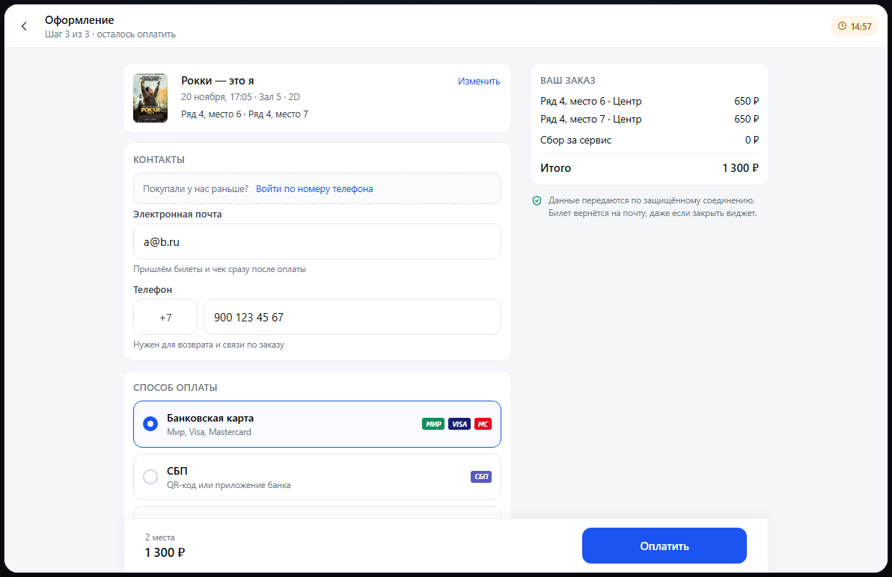
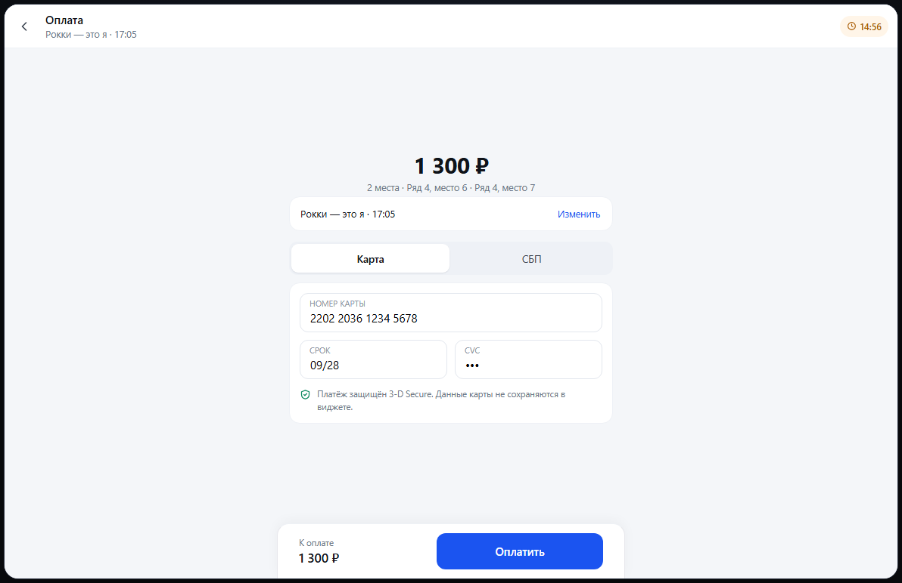
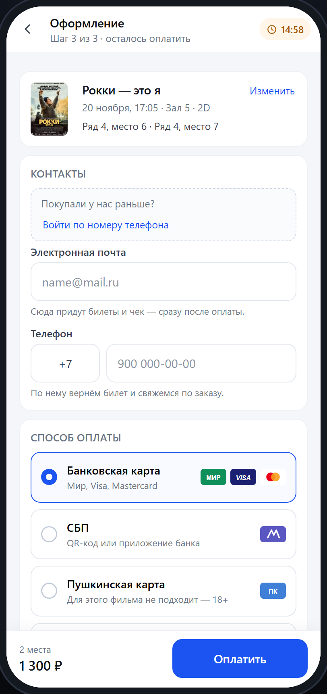
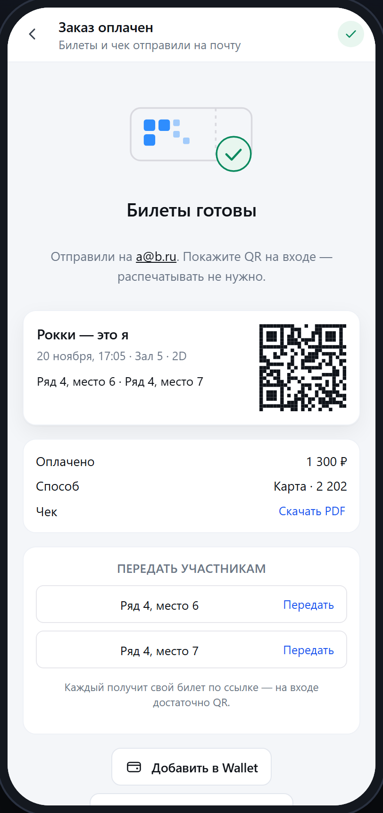

# Стили и токены виджета Киноплан

**Метод:** снято с живого виджета `kinowidget.kinoplan.ru` 20.11.2026 в headless Chrome: вычисленные стили всех видимых элементов на 5 экранах (афиша, зал, контакты, корзина, оплата), плюс разбор 1824 CSS-правил из 4 таблиц стилей (`kinowidget-core`, `vendors`, `old-default` ×2).
**Артефакты:** `tokens/tokens.dtcg.json` (источник), `tokens/tokens-studio.json` (импорт в Figma), `tokens/tokens-flat.json` (плоская сверка), `prototype/tokens.css` (CSS-переменные для макетов), `prototype/tokens-preview.html` (визуальная проверка шкал).

---

## 1. Шрифты

| Что нашли | Значение | Где применяется |
|---|---|---|
| **Manrope** | реально загружается: `Manrope-Light`, `Manrope-Regular`, `Manrope-Bold` (woff2) | `.payment-response`, новые компоненты |
| Системный стек | `BlinkMacSystemFont, -apple-system, "Segoe UI", Roboto, sans-serif` | `body` и все legacy-экраны — основной объём текста |
| **VK Sans Display** | `system-ui, sans-serif` | тема `g-vkgid`, тултип зала |

То есть в виджете **два шрифтовых слоя**: новый (Manrope) и старый (системный). На всех пяти проверенных экранах основной текст отрисован системным стеком — Manrope подключён, но до большинства экранов не доведён.

**Веса:** 300, 400, 500, 600, 700, 800.
**Кегли:** 11, 12, 13, 14, 15, 16, 17, 20, 22, 24 px (плюс 34 px в крупных заголовках) — **10 размеров без шкалы**.
**Межстрочные:** 1.15 (`18.4/16`, `13.8/12`), 1.25 (`20/16`), 1.4–1.5 (`24/16`), 34 px наследуется от 16 px.

Вывод для UI-кита: база — **Manrope**, стек с `BlinkMacSystemFont` только как системный фолбэк, шкала сжимается до 7 ступеней (11/12/13/15/17/22/34 → `xxs…5xl`).

---

## 2. Цвета

Палитра виджета — это **системная палитра iOS**, взятая значениями напрямую:

| Роль | Значение | Где встречается |
|---|---|---|
| Текст основной | `#262626` | 40 объявлений |
| Текст вторичный / плейсхолдер | `#727276` | 29 объявлений |
| Описания, подписи | `#3C3C43` | `text--gray95`, подписи в заказе |
| Плейсхолдер темы vkgid | `#818C99` | тема `g-vkgid` |
| Текст кнопки disabled | `#B0B0B6` | `.button--primary.disabled` |
| **Акцент** | `#0A7AFF` | основная кнопка, активная дата |
| Акцент vkgid | `#0077FF` | `.g-vkgid .button--primary` |
| Нажатие акцента | `rgba(55,136,208,.9)` → ≈ `#3A88D0` | `:active` |
| Ошибка | `#FF3B30` | границы полей, «место заняли» |
| Предупреждение | `#CF7900` | запрет масштаба, предупреждения |
| Фон | `#FFFFFF` | 84 объявления |
| Фон заказа | `#EFEFF4` | `.order-wrapper` |
| Фон subtle | `#F9FAFB` | disabled-поля |
| Вторичная кнопка | `#E7E7EC`, hover `#D9D9DF`, disabled `#F2F2F5` | `.button--secondary` |
| Ссылка по умолчанию | **`rgb(0,0,238)`** | 336 объявлений! |

⚠️ **Находка:** `rgb(0, 0, 238)` — это дефолтный цвет ссылки из браузера (UA-стиль). Он встречается 336 раз — столько элементов наследуют неоформленные `<a>` (например `.nearest-seance-item` в ленте сеансов). Фактически это «утечка» браузерных стилей в интерфейс.

---

## 3. Радиусы, тени, отступы — где дрейф

| Признак | Что в CSS | Вывод |
|---|---|---|
| Радиусы | **12 значений**: 0, 3, 4, 5, 6, 8, 10, 12, 16, 24, 50%, 100%, плюс `8px 8px 0 0` | доминирует 8 px (42 объявления); в токенах оставлено 7 ступеней |
| Тени | 6 разных, в том числе тройная `popover` и `inset`-ринг `#E7E7EC` | сведены к 4 + ринг фокуса |
| Отступы | 10/15/20/30 px (шаг 5) | в токенах сетка 2/4/8/16/20/24/32; 15 и 30 выравниваются |
| Высота контролов | кнопка 48 (padding 10/30), тултип 32, кнопка зума 44 | 32/40/48/56 → токены `size.control.*` |

---

## 4. Два слоя токенов внутри продукта

Виджет уже использует CSS-переменные, но только в части компонентов:

```
--color-text-primary, --color-text-secondary, --color-error-main, --color-bg-wb, --color-bg-gg
--font-size-m-12, --font-size-ml-14, --font-size-l-16, --font-size-xl-24
--font-weight-medium, --font-weight-bold
--radius-m-12, --radius-l-16, --radius-2xl-24
```

Это имена вида `роль-размер`, то есть у них уже есть попытка назвать токены по назначению. Проблема — всё остальное (большинство экранов) захардкожено, и переменные соседствуют с px-значениями в одном файле.

**Что предлагаю:** единственный источник — `tokens/tokens.dtcg.json`. Имена сохраняют их подход (`font.size.m = 14`, `radius.m = 12`), но добавляется слой семантики, которого у них нет вообще.

---

## 5. Архитектура токенов для Figma

Четыре коллекции переменных:

| Коллекция | Режимы | Что внутри | Тип переменной в Figma |
|---|---|---|---|
| **Primitives** | один | gray 25–900, blue 50–600, red, amber, green, zone (side/center/vip), white/black | Color |
| **Semantic** | Light / Dark | text, bg, border, accent, feedback, seat | Color (алиасы на Primitives) |
| **Layout** | один | radius, space, borderWidth, size (control/icon/seat/touchTarget), font.size, font.lineHeight | Number |
| **Component** | Light / Dark | button.*, input.*, sheet.*, seat.* | Color / Number |

Итого **159 токенов**: 82 цвета, 52 размерности, 7 типографических наборов, 6 весов, 5 теней, 1 семейство шрифтов.

**Важное ограничение Figma:** тенями и типографикой переменные не управляют. Поэтому:
- цвета и числа → **Variables** (коллекции выше);
- типографика → **Text styles** (7 штук: display, heading, title, bodyStrong, body, captionStrong, caption);
- тени → **Effect styles** (sm, md, lg, popover) + focus ring;
- шрифты → две **String**-переменные: `font/family/base` = Manrope, `font/family/mono`.

---

## 6. Как импортировать в Figma

Готовые файлы лежат в репозитории:

1. **Tokens Studio → переменные** (быстрый путь):
   - плагин Tokens Studio for Figma → Import → `tokens/tokens-studio.json`;
   - в файле три набора: `core`, `semantic/light`, `semantic/dark` и две темы Light/Dark;
   - Themes → выбрать Light → Export to Figma → Variables;
   - Primitives и Layout попадут как отдельные коллекции, семантика — как коллекция с режимами.
2. **Нативные переменные Figma** (если плагин недоступен): создать 4 коллекции по таблице выше и импортировать из `tokens/tokens-flat.json` (плоский список «имя — тип — значение»).
3. **Текстовые и эффект-стили** — по `typography.*` и `shadow.*` из `tokens.dtcg.json`.
4. **Проверка:** открыть `prototype/tokens-preview.html` — там те же значения отрисованы; расхождений быть не должно.

> Figma-коннектор в этой сессии не подключён, поэтому переменные не созданы внутри файла. Всё, что нужно для импорта, подготовлено; после подключения могу собрать UI-кит прямо в Figma на этих коллекциях.

---

## 7. Что собирать на этих токенах (состав UI-кита)

| Компонент | Обязательные токены |
|---|---|
| Button (primary / secondary / disabled) | `component.button.*`, `size.control.lg`, `radius.md`, `typography.bodyStrong` |
| Input / Phone | `component.input.*`, `size.control.lg`, `feedback.error` |
| Badge | `radius.xs`, `bg.muted`, `accent.*`, `feedback.*` |
| Seat (available по зоне / taken / selected) | `color.seat.*`, `size.seat.sm/md/lg`, `radius.xs` |
| Zone chip | `color.seat.available*`, `border.default`, `radius.full` |
| Seat tooltip | `shadow.md`, `radius.lg`, `bg` тёмный `#0F1319` (наше расширение) |
| Card / Sheet | `component.sheet.*`, `shadow.lg` |
| Ticket | `shadow.md`, `radius.xl`, типографика title/body |
| Stepper / Timer | `feedback.warningSurface`, `font.size.xs`, tabular-nums |

**Правила, которые предлагаю зафиксировать:**
- высота любого интерактивного контрола — только `size.control.*` (32/40/48/56);
- зона нажатия не меньше `size.touchTarget` (44) — кресло в зале тоже;
- радиусы только из шкалы: 4 / 6 / 8 / 12 / 16 / 24 / full;
- цвет зоны зала никогда не совпадает с цветом выбранного места;
- ни одного «сырого» hex в компонентах — только переменные.

---

---

## 9. Движение

Добавлено в токены (`motion.duration.*`, `motion.easing.*`) — 8 длительностей и 3 кривые, всё в `tokens/tokens.dtcg.json`.

| Токен | Значение | Где |
|---|---|---|
| `motion.duration.press` | 120 ms | `:active` кнопки, сжатие 0.98 |
| `motion.duration.hover` | 160 ms | фон, цвет, обводка, тост |
| `motion.duration.pop` | 180 ms | карточка места, чипс, тултип |
| `motion.duration.state` | 200 ms | затемнение фона под шторкой |
| `motion.duration.sheet` | 300 ms | шторка входа, нижний лист |
| `motion.duration.enter` | 360 ms | появление экрана, блоки успеха |
| `motion.duration.draw` | 700 ms | отрисовка галочки на иллюстрации |
| `motion.duration.stagger` | 40 ms | очередь карточек на успехе |
| `motion.easing.out` | `cubic-bezier(.22,1,.36,1)` | появления |
| `motion.easing.inOut` | `cubic-bezier(.65,0,.25,1)` | размер, поворот, фон |
| `motion.easing.spring` | `cubic-bezier(.34,1.3,.64,1)` | перескок (кноб, ползунок) |

**Правила, которые соблюдены в прототипе:**
- анимируются только `transform` и `opacity` — ничего с `height`, `top`, `width`;
- **цены и суммы не анимируются** (никакого счётчика цифр): значение меняется мгновенно, двигается только сама кнопка/чипс;
- на экран — один-два момента: места «подпрыгивают» при выборе, экран мягко въезжает, успех собирается очередью; таймер и легенда не двигаются;
- `prefers-reduced-motion` — всё 1 ms, а не «выключено», чтобы не ломать обработчики;
- тень используется только на плавающих слоях (шторка, тост), карточки разделяются фоном и обводкой.

## 10. Графика

Иллюстрации — минимальный набор из двух, оба в SVG, собраны из тех же токенов, без градиентов и стоковых «человечков»:

| Иллюстрация | Где | Состав |
|---|---|---|
| Билет с QR и галочкой | экран «Билеты готовы» | контур билета `border.strong`, QR-блоки `accent.default`, бейдж `feedback.success` + `successSurface`, галочка рисуется `stroke-dashoffset` за 700 ms |
| Телефон и СМС-облако | шторка входа | контур `accent.default` 2 px, заливка линий `accent` с прозрачностью 35 % |

Правила графики:
- один стиль линии — 2 px, скругления из шкалы радиусов;
- цвет — только из семантики (`accent`, `success`, `border`), без своих hex;
- иллюстрация не единственный носитель смысла: рядом всегда текст;
- иконки — 20/24 в одном стиле (line), тач-таргет 44 px;
- никаких теней и «стекла» в иллюстрациях.

## 11. Что из этого уже в прототипе

- `prototype/tokens.css` — 170 токенов, включая движение; сгенерирован из `tokens.dtcg.json`.
- `prototype/styles.css` — ключевые кадры `screen-in`, `seat-pop`, `tip-in`, `chip-in`, `rise-in`, `illu-check`, правила reduced-motion.
- `prototype/index.html` — шторка входа с анимацией, тост, иллюстрации, отрисовка галочки.
- `prototype/tokens-preview.html` — разделы «Радиусы», «Тени», «Отступы»; движение показано живой кнопкой (см. ниже).
## 12. Переполняемость: правила и проверка

Первая версия афиши не держала контент: флаг «мало мест» был `position: absolute` в углу карточки и накрывал цену, а `Зал 7 · 1050 ₽` стоял одной строкой с `nowrap` и выезжал за карточку. Исправлено структурно.

**Что поменялось в карточке сеанса:**
- флаг «мало мест» — **в потоке**, отдельной строкой сверху, а не поверх текста;
- зал и цена — **две отдельные строки**: зал до двух строк с эллипсисом, цена отдельной строкой с табличными цифрами;
- карточка — `flex` по вертикали, `min-width: 0`, `overflow: hidden` как страховка; высоты в ряду выравниваются сеткой.

**Правила, которые теперь действуют во всём макете:**

| Правило | Зачем |
|---|---|
| Ни одного `position: absolute` для смысловых подписей — только для иконок и декора | абсолютный бейдж всегда рано или поздно накроет текст |
| Длинный текст — до 2 строк с `-webkit-line-clamp` + `title` с полным текстом | сохраняет ритм и не теряет данные |
| `min-width: 0` у каждого flex/grid-ребёнка | иначе элемент не даёт себя сжать и вылезает |
| Цена и числа — `font-variant-numeric: tabular-nums`, отдельной строкой | не «пляшут» и не ломают ширину |
| Кнопка в липкой панели — `auto`, сумма — `minmax(0, 1fr)` | сумма никогда не сжимается, кнопка не вылезает |
| Длинные email/адреса в поле — `text-overflow: ellipsis` | видно, что ввод обрезан, но он скроллится |
| У любой обрезанной строки есть `title` | полный текст доступен с клавиатуры и на десктопе |

**Проверка автоматизирована:** `_research/stress-test.mjs` (Node + CDP).

Что делает тест:
1. подставляет стресс-контент: длинные названия фильмов, зал «Премьер» IMAX, цену `от 10 500 ₽`, лишние бейджи, 6 мест, длинный email;
2. ищет `scrollWidth > clientWidth` у элементов с `overflow: hidden` (кроме полей ввода и намеренных `ellipsis`/clamp);
3. ищет выход детей за границы родителя больше 2 px;
4. ищет **наложение** текстовых блоков внутри карточек (площадь пересечения > 25 %);
5. прогоняет экраны афиша → зал → оформление → успех, а афишу ещё и на ширине 320 px.

Результат на текущем макете:

```
афиша · стресс ......... нарушений 0
зал · 6 мест ........... нарушений 0
оформление · 6 мест .... нарушений 0
оформление · email ..... нарушений 0
успех · 6 мест ......... нарушений 0
афиша · ширина 320 ..... нарушений 0
```

Запуск: `node _research/stress-test.mjs` (нужен Chrome с `--remote-debugging-port=9222`).
## 13. Ширина контролов на десктопе

Отдельный класс ошибок, который я допустил дважды: мобильные элементы, растянутые на всю ширину большого экрана.

**Что было не так (замерено на 1180 px):**

| Элемент | Ширина | Проблема |
|---|---|---|
| кнопка «Оплатить» в липкой панели | 1023 px | кнопка во весь экран |
| липкая панель целиком | 1180 px | полоса через весь виджет |
| поле почты на оформлении | 592 px | поле на треть экрана |
| кнопки на экране успеха | 528 px | «Купить ещё» шириной в полэкрана |
| панель входа | 1180 px | нижняя шторка на весь десктоп |

**Правила, которые теперь действуют:**

1. Десктоп получает **свою форму**, а не растянутую мобильную: вход — правая панель 392 px, оплата — карточка 460 px по центру, оформление — две колонки 520 + 320.
2. У каждой кнопки действия есть верхняя граница: `max-width: 340 px`, `width: auto`. Кнопка не тянется на всю панель.
3. Липкая панель выравнивается по ширине контента (860 px на оформлении, 460 px на оплате), а не по ширине экрана.
4. Поля ввода ограничены шириной колонки (≈500 px), длинные адреса обрезаются эллипсисом.
5. Контент коротких экранов центрируется по вертикали, чтобы не оставлять пустоту под формой.

**Проверка:** автотест меряет ширину всех `button.btn`, полей, `.payopt`, `.sticky-cta` и падает, если что-то шире 380 px (кроме таблиц и картинок). Результат после правок — 0 нарушений на всех экранах.



## 14. Каркас, иконки и микротексты

### 14.1 Каркас: одна анатомия на все экраны

| Слой | Правило | Что было |
|---|---|---|
| Шапка | `.screen-head`: назад (36×36), заголовок 15/600, подпись 12.5 muted, опциональный бейдж-галочка | у экрана успеха шапки не было вообще |
| Заголовки состояний | `.state__title`, `.empty-state__title`, `.soldout__title`, `.success__title` — **20 px, 600** | 17 / 19 / 21 px — четыре разных размера |
| Заголовки секций | `.card__title` — 12 px, uppercase, muted | 13 px местами |
| Контент | `.screen__scroll` + `.screen__body` с полями 16 | успех жил в своей сетке |
| Док | `.sticky-cta` (оформление, оплата), `.sheet` (зал) | у успеха дока нет — низ обрывался |
| Состояния | `.state` / `.empty-state` / `.soldout` — одинаковые паддинги и центрирование | у каждого свои |

Правило: **новый экран = шапка + контент + док**, без исключений. Экран успеха теперь подчиняется тому же каркасу: шапка «Заказ оплачен», бейдж-галочка, контент в `.screen__scroll`.

### 14.2 Иконки

Было: сначала мои текстовые плашки `МИР / VISA / MC / СБП / ПК`, потом самодельные SVG-марки. И то, и другое — замена реальных ассетов.

**Стало: иконки взяты из самого виджета.** Проверил список способов оплаты в продукте (`audit/before/15-current-payment-methods.png`) и вытащил его ассеты:

| Способ оплаты | Что в продукте | Что в макете |
|---|---|---|
| СБП | `/img/payment/sbp.svg` | **тот же файл** (`prototype/img/pay/sbp.svg`) |
| Пушкинская карта | бейдж Пушкинской карты | `/img/pushkin_badge.svg` из виджета |
| Карта | **серая карточка без марок Мир/Visa/MC** | нейтральная иконка карты, как в продукте |

Важный вывод: **в текущем виджете марок платёжных систем нет вообще** — на карте стоит нейтральная серая карточка. Мои «Мир / Visa / Mastercard» были выдумкой, а не улучшением. Убрал.

| Группа | Знаки | Размер |
|---|---|---|
| Способы оплаты | `sbp.svg`, `pushkin_badge.svg` (ассеты виджета), нейтральная карта | 22–24 px |
| Утилитарные | `icon-wallet`, `icon-share`, `icon-card`, `icon-check` | 24×24, линия 1.7 |

Файлы лежат в `prototype/img/pay/`, происхождение — из `kinowidget.kinoplan.ru`, то есть это ассеты самого продукта, а не перерисовка.

Правила:
- одна сетка 24 и одна толщина линии 1.7–2 для утилитарных, 32×20 для марок;
- у марки платёжной системы нет подписи — она узнаваема; у остальных иконок подпись есть;
- иконка в кнопке — 18 px и `aria-hidden`, действие называет текст;
- внешние файлы не подключаем: спрайт внутри HTML, чтобы работал по `file://`.

**Оговорка:** логотипы (Мир, Visa, Mastercard, СБП, Пушкинская карта) в макете — упрощённые рисованные марки для прототипа. Для прода нужны официальные ассеты по бренд-гайдам, это задача продукта и юристов.

### 14.3 Микротексты

Отдельный документ — [MICROCOPY.md](MICROCOPY.md): голос, глоссарий, правила, таблица «было → стало», строки по экранам. Ключевое:
- один смысл — одно слово («места», «билеты», «сеанс», «зал»);
- кнопка = глагол + объект;
- ошибка = что случилось + что делать, без «Ошибка!»;
- «Бесплатно» вместо «0 ₽»;
- суммы с неразрывными пробелами.



## 15. Воздух, единые поля, размер кресел

### 15.1 Воздух

Плотность была высокой: карточки с padding 13, отступы секций 10–12, лист зала 10. Поднято до 8pt-сетки и выше:

| Элемент | Было | Стало |
|---|---|---|
| Поля экрана | 16 | 20 |
| Карточка | padding 13, margin 10, радиус 10 | padding 18, margin 14, радиус 12 |
| Заголовок секции до контента | 10 | 14 |
| Лист зала | padding 10 16 | padding 14 20 |
| Липкая панель | padding 10 16 | padding 12 20 |
| Строка фильма (десктоп) | padding 18 | padding 22 |
| Состояния по центру | 26–36 | 32 |
| Легенда зала | три строки + подсказка | две строки, подсказка убрана |

### 15.2 Поля: один размер на весь виджет

| Поле | Было | Стало |
|---|---|---|
| Email | высота 48, радиус 11 | **48, радиус 8** |
| Телефон | 48, но **две рамки** | 48, радиус 8, одна рамка |
| Пароль | 48, радиус 11 | 48, радиус 8 |
| Поля карты | 52, радиус 11 | 52, радиус 8 |

Правило: `--field-h: 48px`, `--radius-md: 8px`, рамка `1px border.default`, фокус — кольцо 3px `accent.subtle`. Вход внутри группы (телефон) не имеет своей рамки.

### 15.3 Кресла и залы

Ошибка: я «замельчил» кресла — в большом зале включил компактный режим 15 px, чтобы влезло 396 мест. Это противоречит главному: по креслу надо попасть пальцем.

| Что | Было | Стало |
|---|---|---|
| Кресло на мобильном | 20–23, в большом зале **15** | **22**, как в реальном продукте: 13 колонок зала влезают в ширину |
| Кресло на десктопе | 32 | 32 |
| Большой зал (18×22) | кресла сжимались до 15 | **тот же размер 22**, схема прокручивается, панель зума закреплена |
| Зум | декоративные «+/−» | **рабочий**: 22 → 26 → 30 → 34 px |
| Отступ между креслами | 2–4 | 6 (8 по ряду) |

Правило: размер кресла не уменьшается ради вместимости. Вместимость решается прокруткой и зумом.
## 16. Открытые вопросы

1. **Manrope** — нужно подтвердить, что это согласованный бренд-шрифт (свободная лицензия SIL OFL, так что технических ограничений нет) и что legacy-экраны на системный стек остаются осознанно.
2. **Тёмная тема** — в виджете её нет; значения в `semantic/dark` это предложение, его надо утвердить.
3. **VK Sans Display** — оставить отдельной темой `vkgid` или свести к одному шрифту.
4. **`rgb(0,0,238)`** — сначала починить наследование цвета ссылок, иначе токен `text.link` не применится.
