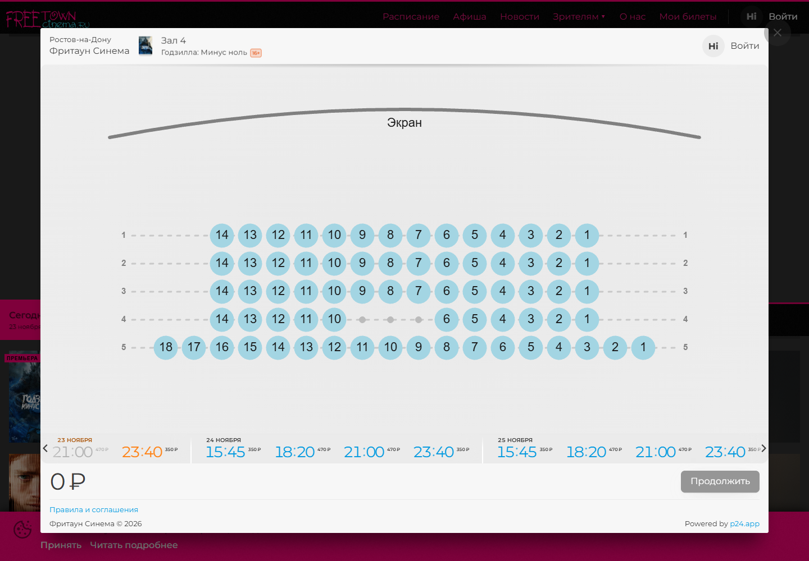
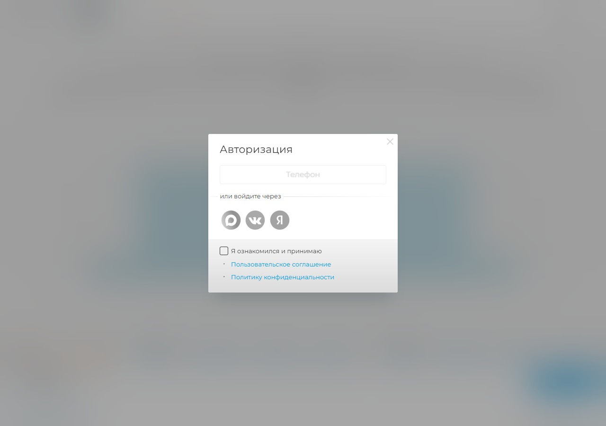

# Конкурентный анализ: виджет продажи билетов «Горизонт»

Дата: 23.11.2026. Готов к показу руководителю. Детали — в трёх файлах:
[SWOT](competitor_swot.md) · [матрица фич](competitor_features.md) · [UX-паттерны](competitor_ux_patterns.md).
Наблюдения по залам — в [BENCHMARK.md](BENCHMARK.md), публичные кейсы — в [PRACTICES.md](PRACTICES.md).

## 1. Executive summary

Рынок продажи кино делится на агрегаторы, которые владеют поиском (Яндекс Афиша, KASSIR.RU,
Ticketland, МТС Афиша), сети со своим приложением (КАРО, «Синема Парк»/«Формула Кино») и локальные
сайты вроде Фритаун Синема на движке p24.app. Базовый уровень у всех уже одинаков: схема зала,
серая занятость, дуга «Экран», зум, итог и кнопка внизу, билет на email. Различаются три вещи —
когда видна цена, обязателен ли вход и сколько экранов до оплаты. Прямой сосед по Ростову
выигрывает современным интерфейсом, но требует авторизацию перед оформлением и не показывает
цену в зале; агрегаторы выигрывают охватом, но ведут покупку в 5 шагов. Среди проверенных
сервисов мы не нашли того, кто соединяет прозрачную цену, гостевую покупку и один экран
оформления. Поэтому наша стратегия — не догонять Яндекс по функциям, а быть самым коротким
и честным по цене путём к билету.

## 2. Кого и как сравнивал

| Роль | Сервисы | Почему они в списке | Как проверял |
|---|---|---|---|
| Агрегаторы | Яндекс Афиша (+ Кинопоиск), KASSIR.RU, Ticketland, МТС Афиша | владеют спросом и задают ожидания по цене, входу, возвратам | живые экраны 20–23.11 и справки; KASSIR — по запуску и описанию |
| Сети | КАРО, «Синема Парк»/«Формула Кино» | свой сайт и приложение, лояльность, «без сбора» | живые экраны и описания приложений |
| Локальный сосед | Фритаун Синема (p24.app) | тот же город и та же задача, современный интерфейс | живой проход 23.11.2026, 5 кадров в `audit/` |
| Зарубежные | Fandango, AMC, Atom Tickets, Cineplex | там уже прошли путь «цена, сбор, места, компания» | публичные страницы, справки, судебные документы; гео-блок не дал открыть интерфейс |

Ограничение: зарубежные интерфейсы из России не открываются, поэтому это не собственный замер,
а документы и публичные описания. Основная матрица и борд — **5 сервисов: наш, Яндекс Афиша,
Кассир.ру, Фритаун, Киноафиша**; Fandango, AMC, Atom, Cineplex — зарубежный контекст, не в матрице.
Ticketland и KASSIR.RU смотрел на театральных событиях — их зоны и диапазон цен переношу как
паттерн движка. Где не видел экран — в матрице стоит «—», а не «нет».

## 3. Три разрыва, которые видно по кадрам

| Разрыв | Кто уже закрывает | Что делаем мы |
|---|---|---|
| Цена в списке сеансов | КАРО («от 360 ₽»), Фритаун («от 350 ₽»), KASSIR (диапазон) | «От» при нескольких тарифах, точное число при одном |
| Цена и зона в зале | Киноплан — зоны в больших залах; Яндекс — карточка «Премиум · 970 ₽»; Ticketland — подписи зон без цен | Зоны во всех залах с тарифами + цена главной в тултипе |
| Короткий гостевой путь | Яндекс пускает гостя, но ведёт в 5 шагов; Фритаун коротко, но требует вход | 4 экрана, гость по умолчанию, вход — выгодой |

Длину пути у Ticketland и КАРО не измерял, поэтому в «короткие» или «длинные» их не ставлю.
Квадрант из прошлой версии убран: он опирался на непроверенные допущения.

## 4. Матрица: главное

| Признак | Киноплан сейчас | Я.Афиша | Кассир.ру | Фритаун | Киноафиша | Наш план |
|---|---|---|---|---|---|---|
| Цена «от» в карточке сеанса | ❌ цены нет | ❌ | ⚠️ диапазон | ✅ | ✅ | ✅ |
| Ценовые зоны на схеме | ⚠️ есть в больших залах | ⚠️ категория в карточке | — | ❌ | ✅ POP/VIP | ✅ |
| Цена места до выбора | ⚠️ есть, не читается | ⚠️ после выбора | — | ❌ | ⚠️ | ✅ |
| Гостевая покупка | ✅ | ✅ | — | ❌ | — | ✅ |
| Один экран оформления | ❌ | ❌ | — | — | — | ✅ |
| Таймер удержания в зале | ❌ только на оплате | ⚠️ | — | ❌ | — | ✅ |
| Зал с клавиатуры | ❌ | — | — | ❌ | — | ✅ |
| Места рядом для компании | ❌ | ❌ | ❌ | ❌ | ❌ | ✅ |

Полная матрица на 14 фич — [competitor_features.md](competitor_features.md).

## 5. SWOT: по два пункта

| Конкурент | Сильное | Слабое | Что это даёт нам |
|---|---|---|---|
| Яндекс Афиша | охват, Яндекс ID, СБП/Сплит, возвраты | 5 шагов, вход навязывается, цены нет в списке | быть короче на 2–3 экрана |
| KASSIR.RU | 540+ кинотеатров, автовозвраты | кино-раздел молодой, Пушкинской карты ещё нет | локальность и понятность на старте |
| Ticketland | зоны, Пушкинская карта | сбор до 10 % и невозвратен | показать полную цену сразу |
| МТС Афиша | нулевой сбор (заявлен), кэшбэк | покрытие и сбор на 2026 не подтверждены | не проигрывать по итоговой цене |
| КАРО | без сбора, KARONA до 15 % | одна сеть, app-first | локальная лояльность |
| Фритаун/p24 | локальный, быстрый, цена в полосе сеансов | обязательный вход, нет цены в зале, canvas, мелкие кресла | обойти по гостю и прозрачности |
| Fandango / AMC | широта, выбор мест | комиссия всплывала в конце → иски | цена до выбора как преимущество |
| Atom / Cineplex | переключение сеансов, таймер, сетка сбора | — | забрать паттерны, не копируя сбор |

## 6. UX-паттерны: стандарт и решения

**Стандарт, который нельзя нарушать:** дуга «Экран», заливка свободных мест и серый цвет занятых,
номера рядов с двух сторон, зум, итог и кнопка внизу, цена и время в списке сеансов, билет на email,
удержание мест.

**Где рынок расходится и что выбираем мы:**

1. **Цена** — тултип с ценой есть почти у всех (Яндекс, Киноплан, seats.io); различие в том,
   читается ли цена. У нас она одного веса с рядом и местом. Выбираем: цена 25 px главная,
   ряд/место — 11 px, плюс «от» в сеансе и зоны в легенде.
2. **Вход** — гость (Яндекс, Fandango) или стена (Фритаун/p24). Выбираем гостя;
   вход предлагаем выгодой — сохранённые контакты и карта.
3. **Оформление** — 5 шагов у Яндекса, 3 у Киноплан, многошаговое у Fandango/Cineplex.
   Выбираем один экран: контакты + сводка + способ оплаты.
4. **Бронь** — таймер только на оплате (Яндекс, Cineplex) или нигде (Фритаун). Выбираем три
   состояния: «выбор сохранён» → «места удерживаются» → «ждёт оплаты».
5. **Сбор** — назван до оплаты (Cineplex, Ticketland) или в конце (Fandango, AMC — иски). Выбираем
   сумму без сюрпризов до кнопки.
6. **Мобильный зал** — вписать всё (Фритаун: кресла ~18 px) или увеличить (Яндекс, Ticketland).
   Выбираем крупное кресло и зум.

**Что не берём:** пять шагов, обязательный вход, одну цену на зал, сбор на последнем экране,
зал «любой ценой в экран».

## 7. Дифференциаторы и риски

**Дифференциаторы (проверять, а не обещать):**

- цена в сеансе и зоны с ценами в легенде — до подтверждения, итог — без сюрпризов;
- гостевая покупка при полном сценарии, вход — по желанию;
- один экран оформления вместо трёх-пяти;
- подбор соседних мест для компании — этого нет ни у кого из проверенных;
- восстановление выбора после конфликта или смены сеанса.

**Что точно внедряем (13 фич MVP):** цена «от» в сеансе, зоны в легенде, тултип с ценой,
крупное кресло, зал на весь экран, нижний лист мест, конфликт мест, один экран оформления,
сводка заказа, активная кнопка, «Билеты готовы», «Оплата обрабатывается», события воронки.
Обоснование и что отложено — в [prioritization.md](prioritization.md) и
[mvp_scope.md](mvp_scope.md); аудит — в [AUDIT-HEURISTIC.md](AUDIT-HEURISTIC.md).

**Риски:**

1. **Агрегатор владеет поиском.** Виджет видит только тех, кто уже нажал «Купить» на сайте
   кинотеатра. Бенчмарк не решает проблему спроса — только потерь внутри виджета.
2. **Прозрачность цены против бизнес-модели.** Если кинотеатр захочет сбор, его придётся
   показывать сразу — иначе повторяем ошибку Fandango/AMC.
3. **Данные зон.** Цены и зоны должны прийти из кассы; выдуманные числа в макете запрещены
   (`AGENTS.md`), а без данных зоны не рисуются.
4. **Соблазн обязательного входа.** CRM хочет аккаунт, конверсия — гостя. Бенчмарк на стороне гостя.
5. **Canvas и вендор.** Схема Киноплан — canvas; клавиатурный режим и скринридер требуют
   переделки движка, а не только вёрстки.
6. **Юридические условия.** Пушкинская карта, согласия, возвраты — здесь мы догоняем агрегаторы,
   а не выигрываем; их нельзя «нарисовать».

## 8. Как подать это в тестовом

1. **Сначала вывод, потом список.** Первый экран — 5 предложений: что рынок уже умеет, где
   разрыв, что мы делаем иначе. Перечень конкурентов — после.
2. **Обосновать выбор, а не перечислить.** Каждый конкурент — в роли: агрегатор, сеть, локальный
   сосед, зарубежный эталон. Без роли список превращается в «я посмотрел интернет».
3. **Матрица вместо стены скриншотов.** Строки — решения (цена, вход, зоны, бронь, оформление),
   колонки — конкуренты и наш план. Table stakes и дифференциаторы — разными блоками.
4. **Один скриншот — один вывод.** Кроп, подпись «что видно → что берём». Пять сильных кадров
   лучше двадцати подряд.
5. **Отделять наблюдение от документа и вывода.** «Видел вживую», «написано в справке»,
   «мой вывод» — разными словами. «—» честнее галочки.
6. **Заканчивать решениями по экранам и границами.** Что меняем в зале, оформлении, оплате;
   что осознанно не берём и почему (виджет — не сайт).
7. **Держать исследование рядом с макетами.** В публичных тестовых выигрывают те, кто кладёт
   ограничения и обоснование рядом с экранами, а не отдельным томом: так делали Валерия Крупина
   (Альфа-Банк), Арман Марабян (Тинькофф), Никита Кузняк (Beeline) — см. [KINOPLAN-CASE.md](KINOPLAN-CASE.md),
   раздел «Что взято из публичных тестовых».
8. **Одна страница для решающего.** 5 выводов + 5 решений + риски. Остальное — приложение.

**Каркас раздела для тестового:** вывод (5 строк) → роли конкурентов → матрица «table stakes /
дифференциаторы» → 3 паттерна с кадрами и подписью «что видно → что берём» → решения по экранам →
риски и ограничения → источники с датами.

**Одна страница + приложения.** На страницу: 5 предложений вывода, топ-5 проблем с severity,
таблица решений по фичам (MVP / после / нет) и блок зависимостей — данные кассы, бэкенд, юрист,
провайдер. В приложения: когнитивный обход по шагам, 10 эвристик, шкала severity, полная таблица
проблем и реестр фич. Отдельным блоком — «вне границ виджета»: поиск, фильтры, выбор площадки,
дата, лояльность; всё, что в макетах выходит за рамку, помечается как «сайт».

**Чего избегать:** списка из 20 конкурентов без ролей; скриншотов без подписей; «✅» там, где не
проверял; SWOT ради SWOT; вывода «сделать как у Яндекса» без привязки к границам виджета; цифр
эффекта без базовой линии.

## 9. Выводы бенчмарка

1. **Цена в сеансе — стандарт.** КАРО и Фритаун показывают «от», у нас цены нет. Закрыть разрыв
   важнее, чем добавить новую фичу.
2. **Тултип с ценой — гигиена, а не преимущество.** Он есть у всех, включая нас. Выигрываем
   иерархией: цена главная, ряд и место вторичны.
3. **Зоны у нас уже есть** в больших залах. Нужна система и постоянство, а не «добавить зоны».
4. **Гость — преимущество против Фритауна.** Вход не должен ломать покупку.
5. **Сбор и статус оплаты — доверие.** Один экран оформления — свободная ниша: его нет
   у проверенных конкурентов.
6. **Места рядом не делает никто.** Это гипотеза для проверки, а не обещание.

Визуальная версия — страница «6. Бенчмарк» в Figma: матрица, три паттерна и выводы.

## 10. Источники

- [Яндекс Афиша — как купить билеты](https://yandex.ru/support/afisha/ru/ticket-purchase) — 5 шагов, 15 минут на оплату, Apple Wallet, подарок; проверено 23.11.2026.
- [KASSIR.RU запустил продажу билетов в кино](https://kzn.kassir.ru/news/6858) — 16.07.2026: 540+ кинотеатров, автовозвраты, Пушкинская карта в планах.
- [Ticketland — есть ли наценка](https://support.mts.ru/ticketland/o-servise-ticketland/est-li-natsenka-na-bileti-na-ticketland) — сбор до 10 %, не возвращается; обновлено 16.01.2026.
- [Ticketland — правила акции по сервисному сбору](http://www.ticketland.ru/files/pdf/service_fee_promo.pdf) — Пушкинская карта без сбора.
- [КАРО — приложение](https://play.google.com/store/apps/details?id=ru.karofilm.app) — без дополнительных сборов, KARONA до 15 %; 07.11.2026.
- [МТС Афиша — запуск](https://media.mts.ru/society/176114) — нулевой сбор, 2019; [исследование МТС Live](https://live.mts.ru/image/pdf/json.tv_loyalty_.pdf) — 2024.
- [Синема Парк / Формула Кино — приложение «Кинотеатры»](https://play.google.com/store/apps/details?id=ru.explosion.kinoteatr.kinoteatr) — 74 кинотеатра, 29 городов.
- [Фритаун Синема — афиша](https://freetowncinema.ru/events) и виджет p24.app — живой проход 23.11.2026, кадры `audit/bench-freetown-*.png`.
- [Cineplex — Family](https://www.cineplex.com/events/family) — сбор $1,50 / $1,00 / 0, первые 4 билета.
- [Fandango Ticket Fee Settlement](https://fandangoticketfeesettlement.com/Home/FAQ) — урегулирование по комиссии, Нью-Йорк, 2022–2024, cap $9 млн.
- [AMC — иск о скрытых сборах](https://www.legal500.com/intelligence/united-states/consumer-protection/amc-faces-class-action-over-hidden-convenience-fees) — 03.09.2026.
- [Atom Tickets — My Seats](https://www.atomtickets.com/help/entry/change-date-and-location) — переключение сеансов из выбора мест.
- [seats.io — objectPopover](https://docs.seats.io/docs/renderer/config-objectPopover/) — цена и категория в карточке, подтверждение на таче.
- [Cinemabox — экран выбора мест](https://wiki.cinemabox.team/books/kassa/page/ekran-vybora-mest) — ценовые пояса.

## 11. Что осталось непроверенным

- Оформление Фритаун/p24 после авторизации — нужен аккаунт; проверен только вход.
- Комиссия Яндекс Афиши именно за кино (справка называет 10 % для театра, для кино — нет).
- Актуальность нулевого сбора МТС Афиши на 2026.
- Интерфейсы Fandango, AMC, Atom, Cineplex из России: только документы и публичные страницы.
- Возврат и лояльность у КАРО и «Синема Парк» — по описаниям приложений, не по проходу.
- Клавиатурный проход по залам Яндекса и Ticketland не делал; в матрице стоит «—».
- Билет Киноплан: экран успеха наблюдался без реальной оплаты — QR, номер заказа, «Скачать билет»; фильма, сеанса и мест на нём нет, PDF не проверен.
