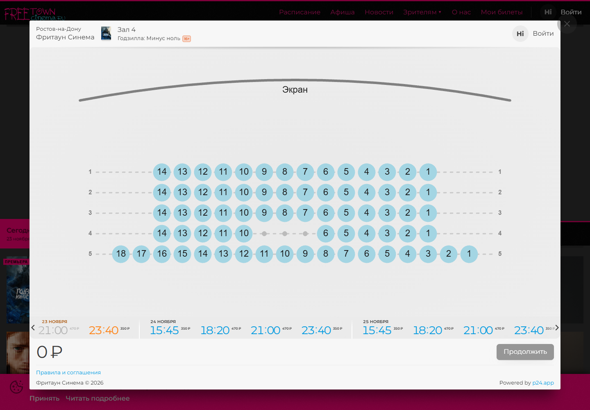
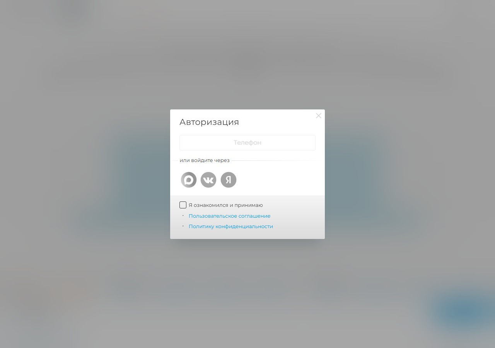
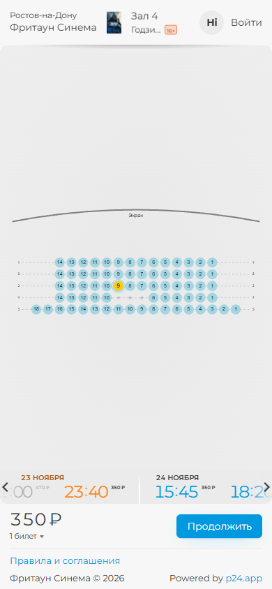

# UX-паттерны конкурентов: стандарт, расхождения, что берём

Дата: 23.11.2026. Наблюдения — живые проходы и справки сервисов; документы движков — отдельно.
Где смотрел только документацию, а не интерфейс, это сказано прямо. SWOT — в
[competitor_swot.md](competitor_swot.md), матрица фич — в [competitor_features.md](competitor_features.md).

## 1. Рыночный стандарт

Это то, что зритель считает само собой разумеющимся. Отклонение читается как «сервис сломан»,
а не как «дизайнерское решение».

| Паттерн | Как выглядит у рынка | Кто подтверждает | У нас |
|---|---|---|---|
| Дуга «Экран» над залом | серая дуга с подписью по центру | Яндекс, Ticketland, Фритаун/p24 | есть, совпало |
| Свободное место — заливка, занятое — серый | круг или кресло залито цветом; серое не нажимается | Яндекс (синие круги), p24 (голубые), Ticketland (заливка), seats.io | сейчас зелёная заливка; в плане — цвет зоны, не «красиво» |
| Номера рядов с двух сторон | ряд подписан слева и справа | Яндекс, p24 | есть |
| Зум «+/−» у схемы | компактно сбоку или под схемой | Яндекс, Ticketland, seats.io | есть под схемой |
| Итог и основная кнопка закреплены внизу | «0 ₽ … Продолжить» / «Купить» | p24, Яндекс | есть, но кнопка бывает неактивна без причины |
| Цена и время в списке сеансов | «23:40 · 350 ₽», «22:10 · от 360 ₽» | Фритаун, КАРО, Fandango, Cineplex | цены в карточке сеанса нет — появляется только в корзине |
| Билет на email + кошелёк/приложение | письмо с QR, Apple Wallet, билет в приложении | Яндекс, КАРО, Cineplex | email и PDF; кошелька нет, билет не проверен |
| Удержание мест на время оплаты | 15 минут, таймер или предупреждение | Яндекс (15 мин), Cineplex (таймер) | таймер только на оплате, состояния не различаются |

**Вывод:** по «гигиене» зала мы уже близки к рынку; отстаём в цене (одна цифра), в состоянии
кнопки и в билете после оплаты.

## 2. Точки расхождения

Здесь рынок решает одну задачу по-разному, и выбор паттерна — это продуктовое решение, а не вкус.

### 2.1 Цена: до выбора или после

- **До подтверждения покупки:** Ticketland подписывает зоны цветными полосами, но цен в кадре нет;
  seats.io показывает карточку места с ценой при ховере и при тапе; КАРО пишет «от 360 ₽» в сеансе.
- **После выбора:** Яндекс показывает цену и категорию в карточке только после выбора места
  («3 ряд, 4 место · Премиум · 970 ₽»), но до оплаты. Фритаун/p24 — только сумму за выбранные
  места внизу, в зале цены нет вообще.

**Что это значит.** Тултип при наведении и тапе — стандарт, а не дифференциатор. Вопрос в том,
читается ли в нём цена: у нас она одного веса с рядом и местом и сливается. Чиним иерархию —
цена 25 px, ряд и место 11 px, зона подписью; в прототипе уже так.

### 2.2 Зоны: цветовые пояса или одна цена

Ticketland (проверял на театральной схеме) подписывает зоны цветными полосами-заголовками
«Партер / Амфитеатр / Балкон», но кресла не красит и цен не показывает. Cinemabox называет это
«ценовыми поясами» и отделяет цвет зоны от цвета состояний. Фритаун/p24 в проверенном зале
держит одну цену за сеанс (350 ₽) и не показывает зон. Яндекс в проверенном кинотеатре тоже
продаёт зал без цветовых зон, но категорию места называет в карточке. У Киноплан зоны уже есть
в больших залах (430/500/530 ₽), но не во всех; в проверенном Зале 5 — одна цена. Вопрос не
в наличии, а в постоянстве.

**Что это значит.** Если у «Горизонта» есть разные цены в зале, одна цифра — ложь, а не упрощение.
Если цены одинаковые — зоны не нужны, и легенда из одной цены честнее. Решение принимается по
данным кинотеатра, а не по красоте макета.

### 2.3 Вход: гость или обязательная авторизация

- **Гость проходит:** Яндекс Афиша (вход советуют, но не требуют), Fandango, Cineplex.
- **Вход обязателен:** Фритаун/p24 — при нажатии «Продолжить» открывается «Авторизация»:
  телефон или VK/Яндекс, чекбокс согласия, и только потом оформление.

**Что это значит.** Для виджета, который открывают из сеанса, обязательный вход — потерянный
заказ: у зрителя нет мотивации заводить аккаунт ради одного билета. Наш гостевой путь — не
«упрощение», а прямое преимущество против локального соседа.

### 2.4 Оформление: один экран или пять шагов

Яндекс ведёт: сеанс → места → личные данные → проверка заказа → оплата. У Киноплан сейчас:
контакты → корзина → оплата. Фритаун/p24 после входа не проверял, но до входа — отдельный экран
авторизации. Fandango и Cineplex тоже многошаговые.

**Что это значит.** Рынок не оптимизирует оформление, потому что продаёт «событие» и боится
юридических ошибок. Мы можем собрать контакты, сводку заказа и способ оплаты на одном экране —
это меньше переходов и меньше мест, где теряется контекст.

### 2.5 Бронь: таймер с зала или только на оплате

Cineplex держит таймер в покупке; Яндекс предупреждает «оплатите в течение 15 минут» на шаге
оплаты; у Киноплан таймер появляется только на экране оплаты — в зале и корзине его нет, и он
не подписан. В зале таймера нет почти нигде — зритель не знает, удерживаются ли места, пока он
думает.

**Что это значит.** Таймер в зале — не украшение: он отвечает на вопрос «я ещё могу подумать?».
Но показывать обратный отсчёт без реального удержания нельзя — это ложь. Отсюда три состояния:
«выбор сохранён» → «места удерживаются N:NN» → «ждёт оплаты».

### 2.6 Сбор: назван до выбора или всплывает в конце

- Ticketland: сбор до 10 % виден в корзине и не возвращается.
- Cineplex: $1,50 онлайн ($1,00 для Scene+, 0 для CineClub), сбор покрывает выбор мест и цифровые билеты.
- Fandango и AMC: комиссия раскрывалась на последних экранах — оба получили иски (Fandango
  урегулировал, фонд до $9 млн; AMC — иск сентября 2026).

**Что это значит.** Сбор сам по себе не убивает покупку; убивает его появление после выбора.
Правило для нас: итоговая сумма с любыми сборами — до кнопки «Выбрать», а лучше — без сбора.

### 2.7 Мобильный зал: вписать или увеличить

Фритаун/p24 вписывает весь зал в 390 px: кресла ~18 px, номера мелкие, название фильма
обрезается. Яндекс и Ticketland дают зум и перенос.

**Что это значит.** «Вписать всё» экономит скролл, но повышает промахи. Наш путь — крупное
кресло (≥23 px), авто-подгонка и зум, а не уменьшение до нечитаемого.

## 3. Рекомендации

| # | Решение | Откуда паттерн | Куда в макете |
|---|---|---|---|
| 1 | Цена «от» в карточке сеанса, диапазон — в подсказке | КАРО, KASSIR.RU, Фритаун | карточка сеанса, афиша |
| 2 | Цвет места = зона, легенда = зона + цена | Ticketland, seats.io | зал, легенда |
| 3 | Тап по месту — карточка «ряд, место, зона, цена» + «Выбрать» | seats.io, Яндекс (карточка после выбора) | зал, мобильный |
| 4 | Полоса сеансов с ценами внутри зала | Фритаун/p24, Atom Tickets | зал, верхняя полоса |
| 5 | Гостевой путь по умолчанию, вход — выгодой, не стеной | Яндекс Афиша | оформление |
| 6 | Один экран: контакты + сводка + способ оплаты | наша гипотеза, рынок не оптимизирует | оформление |
| 7 | Три состояния брони вместо одного таймера | Cineplex (таймер), наша гипотеза | зал, оформление |
| 8 | Сбор (если будет) — в первой сумме, до выбора | Cineplex, урок Fandango/AMC | карточка сеанса, зал |
| 9 | Билет: QR в виджете + email + добавление в кошелёк | Яндекс, КАРО | успех |
| 10 | Клавиатурный режим зала | Яндекс, Ticketland | зал |

## 4. Что не берём

- **Пять шагов оформления** (Яндекс) — виджет должен укладываться в 4 экрана.
- **Обязательный вход** (Фритаун/p24) — теряет гостя и весь сценарий «быстро купить».
- **Цену одной цифрой на зал** (Яндекс, Киноплан сейчас) — при зонах вводит в заблуждение.
- **Сбор на последнем экране** (Fandango, AMC) — юридический и репутационный риск.
- **Зал, вписанный в экран любой ценой** (Фритаун/p24 на 390 px) — промахи и нечитаемые номера.

## 5. Ограничения

- Фритаун/p24 проверен живьём 23.11.2026: афиша, зал, выбор, авторизация, мобильный вид.
  Оформление после входа не проверял — для этого нужен аккаунт.
- Яндекс, Ticketland, КАРО — наблюдения и справки; KASSIR.RU — по запуску и описанию; где не видел
  экран, стоит «—».
- Ticketland и KASSIR.RU проверял на театральных событиях; зоны и диапазон цен переношу как
  паттерн движка, а не как проверенный киноэкран.
- Клавиатурный проход по залу не делал — доступность отмечена как «—», а не ✅.
- КАРО: цена «от 360 ₽» снята на карточке сеанса 23.11.2026; каталог постеров — не расписание.
- Fandango, AMC, Atom, Cineplex — публичные страницы, справки и судебные документы; интерфейсы
  из России не открываются (гео-блок), поэтому это не собственный замер.
- Схемы залов Киноплан и p24 — canvas: клавиатурную доступность проверял по DOM, не по слуху.
